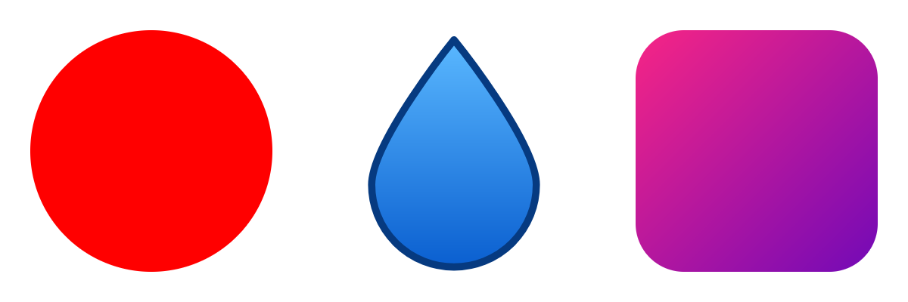

# Skia Game Rendering

[](https://www.nuget.org/packages/SkiaGameRendering) [](https://discord.gg/tG5RBgw)

Draw SkiaSharp vector art, text and SVG straight into MonoGame, KNI, FNA, raylib, Stride, Godot and
Unity textures on the GPU, with no CPU readback.

## Platform Support

| Engine | Backend | Package | Platforms |
|--------|---------|---------|-----------|
| [MonoGame 3.8.4 DesktopGL](docs/desktop/quickstart.md) | OpenGL | [`SkiaGameRendering`](https://www.nuget.org/packages/SkiaGameRendering) | Windows, Linux, macOS |
| [MonoGame 3.8.4 WindowsDX](docs/desktop/quickstart.md) | D3D11 | [`SkiaGameRendering.WindowsDX`](https://www.nuget.org/packages/SkiaGameRendering.WindowsDX) | Windows |
| [MonoGame 3.8.6 WindowsDX12](docs/desktop/quickstart.md) | D3D12 | [`SkiaGameRendering.WindowsDX12`](https://www.nuget.org/packages/SkiaGameRendering.WindowsDX12) | Windows |
| [MonoGame 3.8.4 Android](docs/android/monogame-quickstart.md) | OpenGL ES | [`SkiaGameRendering.Android`](https://www.nuget.org/packages/SkiaGameRendering.Android) | Android 7+ |
| [MonoGame 3.8.4 iOS](docs/ios/quickstart.md) | OpenGL ES | [`SkiaGameRendering.iOS`](https://www.nuget.org/packages/SkiaGameRendering.iOS) | iOS 15+ |
| [KNI DesktopGL](docs/desktop/quickstart.md) | OpenGL | [`SkiaGameRendering.Kni.DesktopGL`](https://www.nuget.org/packages/SkiaGameRendering.Kni.DesktopGL) | Windows, Linux, macOS |
| [KNI WindowsDX](docs/desktop/quickstart.md) | D3D11 | [`SkiaGameRendering.Kni.WindowsDX`](https://www.nuget.org/packages/SkiaGameRendering.Kni.WindowsDX) | Windows |
| [KNI Android](docs/android/quickstart.md) | OpenGL ES | [`SkiaGameRendering.Kni.Android`](https://www.nuget.org/packages/SkiaGameRendering.Kni.Android) | Android 7+ |
| [KNI WebGL (Blazor)](docs/webgl/quickstart.md) | WebGL2 | [`SkiaGameRendering.Kni.WebGL`](https://www.nuget.org/packages/SkiaGameRendering.Kni.WebGL) | Browser |
| [raylib](docs/raylib/quickstart.md) | OpenGL | [`SkiaGameRendering.Raylib.OGL`](https://www.nuget.org/packages/SkiaGameRendering.Raylib.OGL) | Windows, Linux, macOS |
| [raylib WebGL](docs/raylib/webgl-quickstart.md) | WebGL2 | [`SkiaGameRendering.Raylib.WebGL`](https://www.nuget.org/packages/SkiaGameRendering.Raylib.WebGL) | Browser |
| [FNA](docs/fna/quickstart.md) | D3D11 | [`SkiaGameRendering.Fna.WindowsDX`](https://www.nuget.org/packages/SkiaGameRendering.Fna.WindowsDX) | Windows |
| [FNA](docs/fna/quickstart.md) | OpenGL | [`SkiaGameRendering.Fna.OGL`](https://www.nuget.org/packages/SkiaGameRendering.Fna.OGL) | Windows, Linux, macOS |
| [Stride](docs/stride/quickstart.md) | D3D11 | [`SkiaGameRendering.Stride.D3D11`](https://www.nuget.org/packages/SkiaGameRendering.Stride.D3D11) | Windows |
| [Stride](docs/stride/vulkan-quickstart.md) | Vulkan | [`SkiaGameRendering.Stride.VK`](https://www.nuget.org/packages/SkiaGameRendering.Stride.VK) | Windows, Linux, macOS |
| [Stride](docs/stride/d3d12-quickstart.md) | D3D12 | [`SkiaGameRendering.Stride.D3D12`](https://www.nuget.org/packages/SkiaGameRendering.Stride.D3D12) | Windows |
| [Godot 4.7+](docs/godot/quickstart.md) | Vulkan, D3D12, Metal, OpenGL 3.3 | [Source only](docs/godot/quickstart.md) | Windows, Linux, macOS |
| [Unity 6](docs/unity/quickstart.md) | D3D11, D3D12, OpenGL, Metal | [UPM](docs/unity/quickstart.md) | Windows x64, macOS |

## Quick Start

Skia draws straight into whatever the engine is rendering to:



```cs
// once, e.g. in LoadContent
_skia = new SkiaDirectCanvas(GraphicsDevice);
_red = new SKPaint { Color = SKColors.Red, IsAntialias = true };
_drop = new SKSvg(); // Svg.Skia
_drop.Load("drop.svg");
_gradient = new SKPaint
{
    IsAntialias = true,
    Shader = SKShader.CreateLinearGradient(new SKPoint(420, 20), new SKPoint(580, 180),
        new[] { new SKColor(0xF7, 0x25, 0x85), new SKColor(0x72, 0x09, 0xB7) }, SKShaderTileMode.Clamp),
};

// every frame, in Draw
_skia.Begin();
_skia.Canvas.DrawCircle(100, 100, 80, _red);
_skia.Canvas.DrawPicture(_drop.Picture, 220, 20);
_skia.Canvas.DrawRoundRect(new SKRect(420, 20, 580, 180), 32, 32, _gradient);
_skia.End();
```

Setup differs per engine; pick yours from the [table above](#platform-support).

## More

- API: [SkiaRenderTarget2D](docs/documentation/SkiaRenderTarget2D.md), [SkiaDirectCanvas](docs/documentation/SkiaDirectCanvas.md)
- [Samples](samples/README.md)
- [Performance measurements](docs/performance.md)
- [Architecture](docs/architecture.md) and [interop notes](SkiaGameRendering-Notes.md)
- [SkiaSharp drawing docs](https://learn.microsoft.com/en-us/previous-versions/xamarin/xamarin-forms/user-interface/graphics/skiasharp/basics/)

## License

MIT License. See [LICENSE.md](LICENSE.md).

## Credits

Originally created by [Miguel Anxo Figueirido](https://github.com/mfigueirido/SkiaMonoGameRendering).
