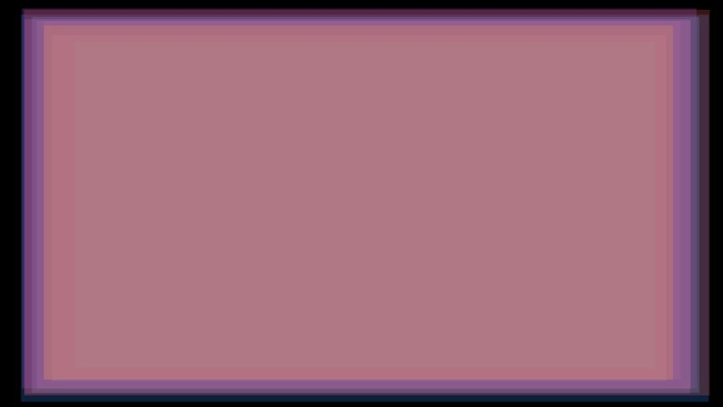
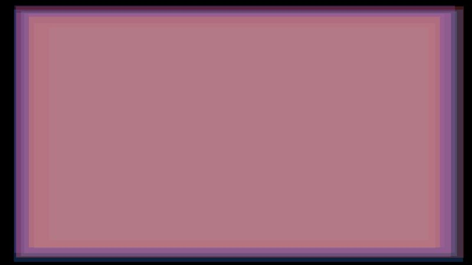

# Fill rate

10 or 40 screen-sized layers drawn over each other, so the cost is almost all pixels, not draw calls. Opaque layers, and translucent ones at 25% alpha.

- **Engine side:** `SpriteBatch.Draw` of a 1x1 white texture stretched over each layer, and `Apos.Shapes` `FillRectangle`.
- **Skia side:** `SKCanvas.DrawRect` per layer.

| Engine | Skia (direct) |
|---|---|
|  |  |

Screenshots: 10 translucent layers, KNI DesktopGL. The scenes are 1600x900 and animate every frame.

## Results

<!-- results:begin -->

### MonoGame DesktopGL, H2

| Scene | Native frame ms | SkiaGameRendering frame ms | Skia time / Native time |
|---|---:|---:|---:|
| Opaque 10 layers | 0.76 (SpriteBatch) | 1.41 | 1.87x |
| Opaque 40 layers | 1.46 (SpriteBatch) | 1.91 | 1.31x |
| Translucent 10 layers | 0.79 (SpriteBatch) | 1.42 | 1.79x |
| Translucent 40 layers | 1.51 (SpriteBatch) | 1.70 | 1.12x |

### KNI DesktopGL, H2

| Scene | Native frame ms | SkiaGameRendering frame ms | Skia time / Native time |
|---|---:|---:|---:|
| Opaque 10 layers | 0.64 (SpriteBatch) | 1.39 | 2.17x |
| Opaque 40 layers | 1.28 (SpriteBatch) | 1.80 | 1.40x |
| Translucent 10 layers | 0.66 (SpriteBatch) | 1.32 | 2.00x |
| Translucent 40 layers | 1.31 (SpriteBatch) | 2.10 | 1.60x |

### KNI WebGL (Chrome), H2

| Scene | Native frame ms | SkiaGameRendering frame ms | Skia time / Native time |
|---|---:|---:|---:|
| Opaque 10 layers | 0.69 (SpriteBatch) | 0.85 | 1.24x |
| Opaque 40 layers | 16.7 (SpriteBatch) | 1.39 | 0.08x |
| Translucent 10 layers | 3.36 (Apos.Shapes) | 0.88 | 0.26x |
| Translucent 40 layers | 13.5 (SpriteBatch) | 1.56 | 0.12x |

<!-- results:end -->

## Reading the numbers

- Desktop: Skia takes 1.1-2.2x as long as `SpriteBatch`, closer at 40 layers than at 10.
- Browser: Skia takes 0.08-0.12x as long at 40 layers, where the engine side stalls.
