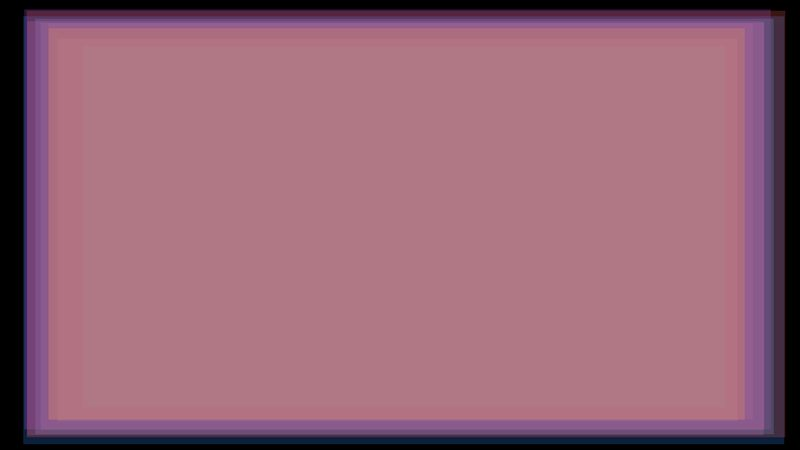
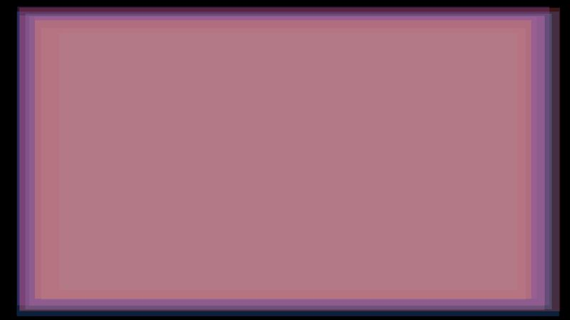

# Fill rate

10 or 40 screen-sized layers drawn over each other, so the cost is almost all pixels, not draw calls. Opaque layers, and translucent ones at 25% alpha.

- **Engine side:** `SpriteBatch.Draw` of a 1x1 white texture stretched over each layer, and `Apos.Shapes` `FillRectangle`.
- **Skia side:** `SKCanvas.DrawRect` per layer.

| Engine | Skia (direct) |
|---|---|
|  |  |

Screenshots: 10 translucent layers, KNI DesktopGL. The scenes are 1600x900 and animate every frame.

## Results

<!-- results:begin -->

### MonoGame DesktopGL

**H2**: Raw 2026-10-23 at 2a3a7c6; Skia 2026-10-23 at 2a3a7c6

| Scene | SpriteBatch FPS | Apos.Shapes FPS | Skia render target FPS | Skia direct FPS | Skia render target / SpriteBatch | Skia direct / SpriteBatch |
|---|---:|---:|---:|---:|---:|---:|
| Opaque 10 layers | 1321 | 152 | 641 | 707 | 49% | 54% |
| Opaque 40 layers | 684 | 43 | 444 | 523 | 65% | 76% |
| Translucent 10 layers | 1259 | 139 | 683 | 704 | 54% | 56% |
| Translucent 40 layers | 661 | 45 | 499 | 589 | 75% | 89% |

Median draw CPU time per frame (ms)

| Scene | SpriteBatch | Apos.Shapes | Skia render target | Skia direct |
|---|---:|---:|---:|---:|
| Opaque 10 layers | 0.028 | 0.112 | 0.206 | 0.196 |
| Opaque 40 layers | 0.054 | 0.200 | 0.305 | 0.229 |
| Translucent 10 layers | 0.039 | 0.114 | 0.165 | 0.125 |
| Translucent 40 layers | 0.053 | 0.203 | 0.254 | 0.190 |

Median / 95th percentile frame time (ms)

| Scene | SpriteBatch | Apos.Shapes | Skia render target | Skia direct |
|---|---:|---:|---:|---:|
| Opaque 10 layers | 0.679 / 1.332 | 1.932 / 20.545 | 1.534 / 1.852 | 1.388 / 1.691 |
| Opaque 40 layers | 1.305 / 2.774 | 4.515 / 87.247 | 2.163 / 2.568 | 1.862 / 2.185 |
| Translucent 10 layers | 0.714 / 1.416 | 1.716 / 27.099 | 1.424 / 1.822 | 1.376 / 1.752 |
| Translucent 40 layers | 1.367 / 2.768 | 19.818 / 86.524 | 1.968 / 2.284 | 1.665 / 1.940 |

### MonoGame WindowsDX

**H2**: Raw 2026-10-23 at 2a3a7c6

| Scene | SpriteBatch FPS | Apos.Shapes FPS |
|---|---:|---:|
| Opaque 10 layers | 1543 | 180 |
| Opaque 40 layers | 775 | 45 |
| Translucent 10 layers | 1479 | 172 |
| Translucent 40 layers | 721 | 44 |

Median draw CPU time per frame (ms)

| Scene | SpriteBatch | Apos.Shapes |
|---|---:|---:|
| Opaque 10 layers | 0.007 | 0.027 |
| Opaque 40 layers | 0.016 | 0.085 |
| Translucent 10 layers | 0.008 | 0.073 |
| Translucent 40 layers | 0.016 | 0.110 |

Median / 95th percentile frame time (ms)

| Scene | SpriteBatch | Apos.Shapes |
|---|---:|---:|
| Opaque 10 layers | 0.628 / 0.758 | 5.414 / 6.169 |
| Opaque 40 layers | 1.257 / 1.616 | 21.995 / 22.604 |
| Translucent 10 layers | 0.657 / 0.821 | 5.600 / 6.216 |
| Translucent 40 layers | 1.291 / 1.732 | 22.573 / 22.820 |

### KNI DesktopGL

**H2**: Raw 2026-10-23 at 1df31c3; Skia 2026-10-23 at 1df31c3

| Scene | SpriteBatch FPS | Apos.Shapes FPS | Skia render target FPS | Skia direct FPS | Skia render target / SpriteBatch | Skia direct / SpriteBatch |
|---|---:|---:|---:|---:|---:|---:|
| Opaque 10 layers | 1570 | 194* | 628 | 722 | 40% | 46% |
| Opaque 40 layers | 780 | 45 | 386 | 557 | 49% | 71% |
| Translucent 10 layers | 1515 | 158* | 687 | 756 | 45% | 50% |
| Translucent 40 layers | 761 | 49* | 412 | 476 | 54% | 63% |
\* A frame took more than 20 times the median (a shader compile or a garbage collection), which drags the average down. The median is in the table below.

Median draw CPU time per frame (ms)

| Scene | SpriteBatch | Apos.Shapes | Skia render target | Skia direct |
|---|---:|---:|---:|---:|
| Opaque 10 layers | 0.032 | 0.097 | 0.368 | 0.182 |
| Opaque 40 layers | 0.066 | 0.155 | 0.399 | 0.160 |
| Translucent 10 layers | 0.036 | 0.103 | 0.334 | 0.148 |
| Translucent 40 layers | 0.093 | 0.147 | 0.441 | 0.296 |

Median / 95th percentile frame time (ms)

| Scene | SpriteBatch | Apos.Shapes | Skia render target | Skia direct |
|---|---:|---:|---:|---:|
| Opaque 10 layers | 0.619 / 0.747 | 0.594 / 18.371 | 1.543 / 1.963 | 1.365 / 1.661 |
| Opaque 40 layers | 1.221 / 1.603 | 16.284 / 82.088 | 2.504 / 2.883 | 1.751 / 2.052 |
| Translucent 10 layers | 0.640 / 0.773 | 0.688 / 18.784 | 1.426 / 1.702 | 1.309 / 1.585 |
| Translucent 40 layers | 1.276 / 1.661 | 0.745 / 80.970 | 2.389 / 2.714 | 2.055 / 2.380 |

### KNI WebGL (Chrome)

**H2**: Raw 2026-10-23 at 1df31c3; Skia 2026-10-23 at 1df31c3

| Scene | SpriteBatch FPS | Apos.Shapes FPS | Skia render target FPS | Skia direct FPS | Skia render target / SpriteBatch | Skia direct / SpriteBatch |
|---|---:|---:|---:|---:|---:|---:|
| Opaque 10 layers | 1452 | 124 | 1597 | 1174 | 110% | 81% |
| Opaque 40 layers | 60 | 43 | 796 | 718 | 1327% | 1197% |
| Translucent 10 layers | 131 | 298 | 1421 | 1140 | 1085% | 870% |
| Translucent 40 layers | 74 | 1 | 534 | 643 | 722% | 869% |

Median draw CPU time per frame (ms)

| Scene | SpriteBatch | Apos.Shapes | Skia render target | Skia direct |
|---|---:|---:|---:|---:|
| Opaque 10 layers | 0.000 | 5.500 | 0.300 | 0.700 |
| Opaque 40 layers | 0.700 | 21.500 | 0.800 | 1.100 |
| Translucent 10 layers | 6.700 | 4.400 | 0.300 | 0.700 |
| Translucent 40 layers | 10.000 | 21.600 | 0.900 | 1.300 |

Median / 95th percentile frame time (ms)

| Scene | SpriteBatch | Apos.Shapes | Skia render target | Skia direct |
|---|---:|---:|---:|---:|
| Opaque 10 layers | 0.100 / 0.300 | 5.900 / 22.500 | 0.500 / 1.400 | 0.800 / 1.200 |
| Opaque 40 layers | 16.100 / 28.300 | 22.900 / 26.700 | 1.100 / 2.900 | 1.300 / 1.900 |
| Translucent 10 layers | 7.500 / 22.000 | 4.700 / 7.700 | 0.600 / 1.400 | 0.800 / 1.200 |
| Translucent 40 layers | 11.400 / 23.300 | 23.200 / 36.900 | 1.500 / 3.900 | 1.500 / 2.100 |

<!-- results:end -->

## Reading the numbers

- `SpriteBatch` is the fastest on the desktop (about 1500 FPS at 10 layers); Skia reaches 40-70% of it. A direct canvas helps most here, because the render target path touches every pixel one more time to composite.
- `Apos.Shapes` is far behind on large rectangles (about 190 FPS at 10 opaque layers): its shader probably does anti-aliasing and rounding math on every covered pixel.
- The browser numbers for the engine side contain stalls and are noisy. Rows marked with an asterisk have one or more frames over 20 times the median.
