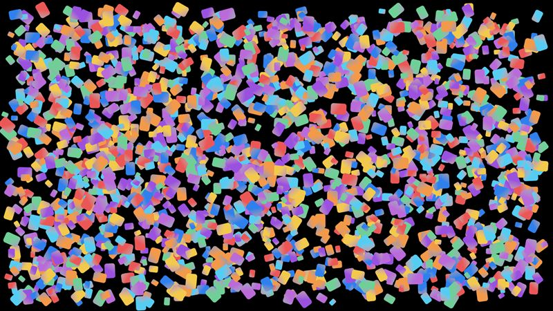
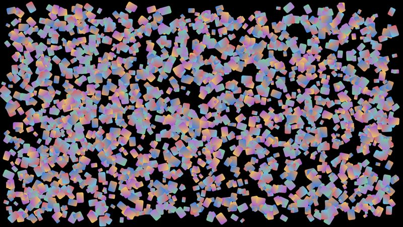

# Gradients

Rounded rectangles filled with a two-color linear gradient that turns with the shape.

- **Engine side:** `Apos.Shapes` `FillRectangle` with a `Gradient` in the shape's own space (`isLocal: true`).
- **Skia side:** One `SKShader.CreateLinearGradient` per rectangle, built once, set on the paint and drawn through a translated and rotated canvas.

| Engine | Skia (direct) |
|---|---|
|  |  |

Screenshots: 2k gradients, KNI DesktopGL. The scenes are 1600x900 and animate every frame.

## Results

<!-- results:begin -->

### MonoGame DesktopGL

**H2**: Raw 2026-10-23 at 2a3a7c6; Skia 2026-10-23 at 2a3a7c6

| Scene | Apos.Shapes FPS | Skia render target FPS | Skia direct FPS | Skia render target / Apos.Shapes | Skia direct / Apos.Shapes |
|---|---:|---:|---:|---:|---:|
| Gradients 500 | 886 | 410 | 444 | 46% | 50% |
| Gradients 2k | 552 | 118 | 123 | 21% | 22% |
| Gradients 10k | 167 | 28 | 28 | 17% | 17% |

Median draw CPU time per frame (ms)

| Scene | Apos.Shapes | Skia render target | Skia direct |
|---|---:|---:|---:|
| Gradients 500 | 0.134 | 1.543 | 1.502 |
| Gradients 2k | 0.346 | 5.780 | 5.666 |
| Gradients 10k | 4.170 | 30.702 | 31.233 |

Median / 95th percentile frame time (ms)

| Scene | Apos.Shapes | Skia render target | Skia direct |
|---|---:|---:|---:|
| Gradients 500 | 0.989 / 2.533 | 2.320 / 3.188 | 2.134 / 3.037 |
| Gradients 2k | 1.632 / 3.161 | 8.278 / 9.801 | 7.822 / 10.125 |
| Gradients 10k | 5.492 / 7.512 | 36.092 / 39.153 | 36.059 / 38.714 |

### MonoGame WindowsDX

**H2**: Raw 2026-10-23 at 2a3a7c6

| Scene | Apos.Shapes FPS |
|---|---:|
| Gradients 500 | 1361 |
| Gradients 2k | 613 |
| Gradients 10k | 167 |

Median draw CPU time per frame (ms)

| Scene | Apos.Shapes |
|---|---:|
| Gradients 500 | 0.095 |
| Gradients 2k | 0.389 |
| Gradients 10k | 3.645 |

Median / 95th percentile frame time (ms)

| Scene | Apos.Shapes |
|---|---:|
| Gradients 500 | 0.712 / 0.939 |
| Gradients 2k | 1.569 / 1.987 |
| Gradients 10k | 5.850 / 6.535 |

### KNI DesktopGL

**H2**: Raw 2026-10-23 at 1df31c3; Skia 2026-10-23 at 1df31c3

| Scene | Apos.Shapes FPS | Skia render target FPS | Skia direct FPS | Skia render target / Apos.Shapes | Skia direct / Apos.Shapes |
|---|---:|---:|---:|---:|---:|
| Gradients 500 | 1451 | 352 | 410 | 24% | 28% |
| Gradients 2k | 711 | 120 | 126 | 17% | 18% |
| Gradients 10k | 191 | 27 | 27 | 14% | 14% |

Median draw CPU time per frame (ms)

| Scene | Apos.Shapes | Skia render target | Skia direct |
|---|---:|---:|---:|
| Gradients 500 | 0.113 | 1.740 | 1.509 |
| Gradients 2k | 0.358 | 5.811 | 5.575 |
| Gradients 10k | 3.998 | 32.612 | 32.380 |

Median / 95th percentile frame time (ms)

| Scene | Apos.Shapes | Skia render target | Skia direct |
|---|---:|---:|---:|
| Gradients 500 | 0.665 / 1.014 | 2.751 / 3.387 | 2.305 / 3.294 |
| Gradients 2k | 1.388 / 1.697 | 8.202 / 9.483 | 7.592 / 9.792 |
| Gradients 10k | 5.021 / 6.643 | 37.188 / 40.125 | 36.857 / 40.476 |

### KNI WebGL (Chrome)

**H2**: Raw 2026-10-23 at 1df31c3; Skia 2026-10-23 at 1df31c3

| Scene | Apos.Shapes FPS | Skia render target FPS | Skia direct FPS | Skia render target / Apos.Shapes | Skia direct / Apos.Shapes |
|---|---:|---:|---:|---:|---:|
| Gradients 500 | 351 | 339 | 316 | 97% | 90% |
| Gradients 2k | 95 | 109 | 99 | 115% | 104% |
| Gradients 10k | 21 | 23 | 22 | 110% | 105% |

Median draw CPU time per frame (ms)

| Scene | Apos.Shapes | Skia render target | Skia direct |
|---|---:|---:|---:|
| Gradients 500 | 0.900 | 2.800 | 3.000 |
| Gradients 2k | 7.900 | 8.900 | 9.800 |
| Gradients 10k | 43.900 | 43.400 | 43.900 |

Median / 95th percentile frame time (ms)

| Scene | Apos.Shapes | Skia render target | Skia direct |
|---|---:|---:|---:|
| Gradients 500 | 1.200 / 3.100 | 2.900 / 3.800 | 3.100 / 3.600 |
| Gradients 2k | 9.000 / 19.900 | 9.200 / 10.500 | 10.000 / 11.600 |
| Gradients 10k | 45.300 / 60.200 | 43.800 / 46.300 | 44.300 / 47.400 |

<!-- results:end -->

## Reading the numbers

- Desktop: `Apos.Shapes` is four to seven times faster. Skia fills each gradient rectangle with a separate shader and draw.
- Browser: the two are about level, because `Apos.Shapes` is CPU-bound in WebAssembly there.
