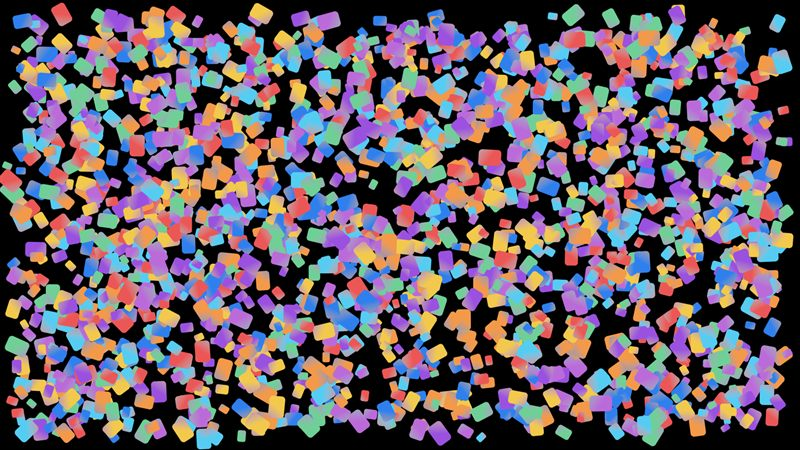
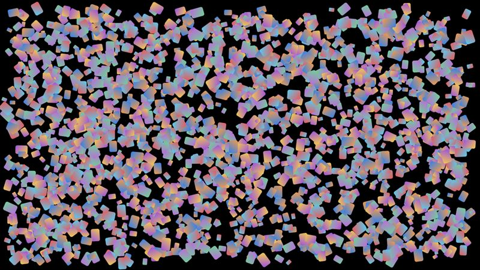

# Gradients

Rounded rectangles filled with a two-color linear gradient that turns with the shape.

- **Engine side:** `Apos.Shapes` `FillRectangle` with a `Gradient` in the shape's own space (`isLocal: true`).
- **Skia side:** One `SKShader.CreateLinearGradient` per rectangle, built once, set on the paint and drawn through a translated and rotated canvas.

| Engine | Skia (direct) |
|---|---|
|  |  |

Screenshots: 2k gradients, KNI DesktopGL. The scenes are 1600x900 and animate every frame.

## Results

<!-- results:begin -->

### MonoGame DesktopGL, H2

| Scene | Native frame ms | SkiaGameRendering frame ms | Skia time / Native time |
|---|---:|---:|---:|
| Gradients 500 | 1.13 (Apos.Shapes) | 2.25 | 1.99x |
| Gradients 2k | 1.81 (Apos.Shapes) | 8.13 | 4.49x |
| Gradients 10k | 5.99 (Apos.Shapes) | 35.7 | 5.96x |

### KNI DesktopGL, H2

| Scene | Native frame ms | SkiaGameRendering frame ms | Skia time / Native time |
|---|---:|---:|---:|
| Gradients 500 | 0.69 (Apos.Shapes) | 2.44 | 3.54x |
| Gradients 2k | 1.41 (Apos.Shapes) | 7.94 | 5.65x |
| Gradients 10k | 5.24 (Apos.Shapes) | 37.0 | 7.07x |

### KNI WebGL (Chrome), H2

| Scene | Native frame ms | SkiaGameRendering frame ms | Skia time / Native time |
|---|---:|---:|---:|
| Gradients 500 | 2.85 (Apos.Shapes) | 3.17 | 1.11x |
| Gradients 2k | 10.5 (Apos.Shapes) | 10.1 | 0.96x |
| Gradients 10k | 47.6 (Apos.Shapes) | 45.5 | 0.95x |

<!-- results:end -->

## Reading the numbers

- Desktop: Skia takes 2.0-7.1x as long as `Apos.Shapes`. Skia fills each gradient rectangle with its own shader and draw.
- Browser: about even (0.95-1.11x), because `Apos.Shapes` is CPU-bound in WebAssembly there.
