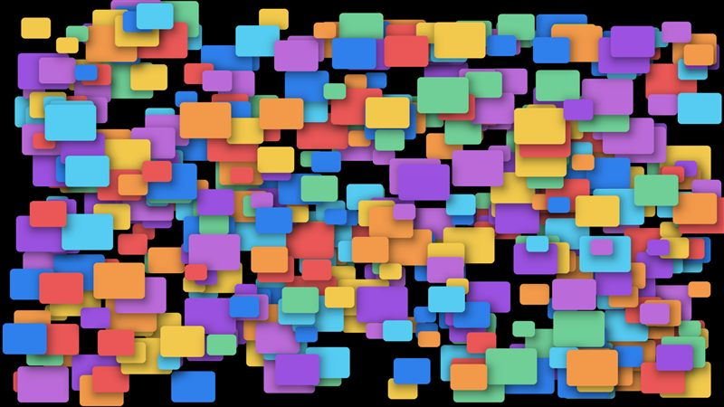
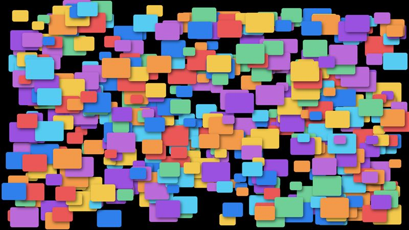

# Drop shadows

Panels with a blurred drop shadow (offset 4, 6; blur 12), the shape UI toolkits draw behind buttons and dialogs. The scenes use five panel sizes, as a UI does; the last scene gives every panel its own size.

- **Engine side:** `Apos.Shapes` `FillRectangleBlurred` for the shadow, then `FillRectangle` for the panel. Blur is computed in the shader, with no extra pass.
- **Skia side:** `SKMaskFilter.CreateBlur` on `DrawRoundRect` for the shadow, then the panel.

| Engine | Skia (direct) |
|---|---|
|  |  |

Screenshots: 500 shadows, KNI DesktopGL. The scenes are 1600x900 and animate every frame.

## Results

<!-- results:begin -->

### MonoGame DesktopGL, H2

| Scene | Native frame ms | SkiaGameRendering frame ms | Skia time / Native time |
|---|---:|---:|---:|
| Shadows 100 | 1.32 (Apos.Shapes) | 8.62 | 6.54x |
| Shadows 500 | 4.63 (Apos.Shapes) | 35.7 | 7.71x |
| Shadows 2k | 16.9 (Apos.Shapes) | 166.7 | 9.83x |
| Shadows 500 unique sizes | 4.85 (Apos.Shapes) | 37.0 | 7.63x |

### KNI DesktopGL, H2

| Scene | Native frame ms | SkiaGameRendering frame ms | Skia time / Native time |
|---|---:|---:|---:|
| Shadows 100 | 1.12 (Apos.Shapes) | 9.43 | 8.39x |
| Shadows 500 | 4.18 (Apos.Shapes) | 35.7 | 8.54x |
| Shadows 2k | 15.6 (Apos.Shapes) | 166.7 | 10.67x |
| Shadows 500 unique sizes | 4.12 (Apos.Shapes) | 37.0 | 9.00x |

### KNI WebGL (Chrome), H2

| Scene | Native frame ms | SkiaGameRendering frame ms | Skia time / Native time |
|---|---:|---:|---:|
| Shadows 100 | 12.0 (Apos.Shapes) | 45.5 | 3.77x |
| Shadows 500 | 37.0 (Apos.Shapes) | 333.3 | 9.00x |
| Shadows 2k | 250.0 (Apos.Shapes) | 1000.0 | 4.00x |
| Shadows 500 unique sizes | 58.8 (Apos.Shapes) | 500.0 | 8.50x |

<!-- results:end -->

## Reading the numbers

- One of the widest gaps in the suite: Skia's blurred rounded rectangle takes 6.5-10.7x as long as `Apos.Shapes` on the desktop and 3.8-9.0x in the browser.
- Giving every panel a unique size makes no measurable difference, so Skia's cached blur is not the limit.
- For many shadows, use a shader (or bake them into a texture) rather than Skia's mask filter.
