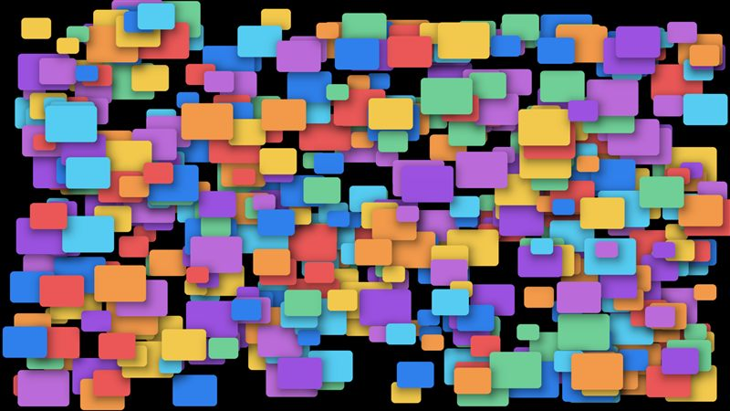
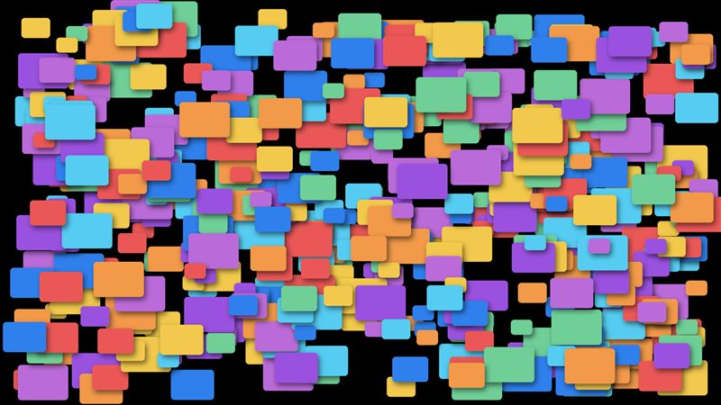

# Drop shadows

Panels with a blurred drop shadow (offset 4, 6; blur 12), the shape UI toolkits draw behind buttons and dialogs. The scenes use five panel sizes, as a UI does; the last scene gives every panel its own size.

- **Engine side:** `Apos.Shapes` `FillRectangleBlurred` for the shadow, then `FillRectangle` for the panel. Blur is computed in the shader, with no extra pass.
- **Skia side:** `SKMaskFilter.CreateBlur` on `DrawRoundRect` for the shadow, then the panel.

| Engine | Skia (direct) |
|---|---|
|  |  |

Screenshots: 500 shadows, KNI DesktopGL. The scenes are 1600x900 and animate every frame.

## Results

<!-- results:begin -->

### MonoGame DesktopGL

**H2**: Raw 2026-10-23 at 2a3a7c6; Skia 2026-10-23 at 2a3a7c6

| Scene | Apos.Shapes FPS | Skia render target FPS | Skia direct FPS | Skia render target / Apos.Shapes | Skia direct / Apos.Shapes |
|---|---:|---:|---:|---:|---:|
| Shadows 100 | 758 | 111 | 116 | 15% | 15% |
| Shadows 500 | 216 | 28 | 28 | 13% | 13% |
| Shadows 2k | 59 | 6 | 6 | 10% | 10% |
| Shadows 500 unique sizes | 206 | 26 | 27 | 13% | 13% |

Median draw CPU time per frame (ms)

| Scene | Apos.Shapes | Skia render target | Skia direct |
|---|---:|---:|---:|
| Shadows 100 | 0.065 | 5.852 | 5.676 |
| Shadows 500 | 0.934 | 28.408 | 28.079 |
| Shadows 2k | 2.992 | 129.422 | 127.652 |
| Shadows 500 unique sizes | 0.954 | 31.515 | 30.433 |

Median / 95th percentile frame time (ms)

| Scene | Apos.Shapes | Skia render target | Skia direct |
|---|---:|---:|---:|
| Shadows 100 | 1.192 / 2.557 | 8.905 / 10.317 | 8.479 / 10.211 |
| Shadows 500 | 4.182 / 6.027 | 35.245 / 37.862 | 35.219 / 37.967 |
| Shadows 2k | 17.073 / 19.002 | 168.722 / 174.632 | 167.473 / 178.928 |
| Shadows 500 unique sizes | 4.533 / 6.502 | 39.164 / 41.706 | 37.044 / 40.984 |

### MonoGame WindowsDX

**H2**: Raw 2026-10-23 at 2a3a7c6

| Scene | Apos.Shapes FPS |
|---|---:|
| Shadows 100 | 790 |
| Shadows 500 | 194 |
| Shadows 2k | 53 |
| Shadows 500 unique sizes | 205 |

Median draw CPU time per frame (ms)

| Scene | Apos.Shapes |
|---|---:|
| Shadows 100 | 0.036 |
| Shadows 500 | 0.457 |
| Shadows 2k | 1.497 |
| Shadows 500 unique sizes | 0.270 |

Median / 95th percentile frame time (ms)

| Scene | Apos.Shapes |
|---|---:|
| Shadows 100 | 1.228 / 1.536 |
| Shadows 500 | 5.041 / 5.761 |
| Shadows 2k | 19.206 / 19.852 |
| Shadows 500 unique sizes | 4.879 / 5.701 |

### KNI DesktopGL

**H2**: Raw 2026-10-23 at 1df31c3; Skia 2026-10-23 at 1df31c3

| Scene | Apos.Shapes FPS | Skia render target FPS | Skia direct FPS | Skia render target / Apos.Shapes | Skia direct / Apos.Shapes |
|---|---:|---:|---:|---:|---:|
| Shadows 100 | 890 | 115 | 106 | 13% | 12% |
| Shadows 500 | 239 | 27 | 28 | 11% | 12% |
| Shadows 2k | 64 | 6 | 6 | 9% | 9% |
| Shadows 500 unique sizes | 243 | 26 | 27 | 11% | 11% |

Median draw CPU time per frame (ms)

| Scene | Apos.Shapes | Skia render target | Skia direct |
|---|---:|---:|---:|
| Shadows 100 | 0.109 | 5.756 | 5.973 |
| Shadows 500 | 0.481 | 28.611 | 28.058 |
| Shadows 2k | 3.012 | 128.697 | 130.280 |
| Shadows 500 unique sizes | 0.548 | 30.920 | 29.702 |

Median / 95th percentile frame time (ms)

| Scene | Apos.Shapes | Skia render target | Skia direct |
|---|---:|---:|---:|
| Shadows 100 | 1.104 / 1.372 | 8.663 / 10.375 | 9.217 / 11.893 |
| Shadows 500 | 4.103 / 4.650 | 36.419 / 39.995 | 35.396 / 38.347 |
| Shadows 2k | 15.720 / 16.354 | 167.362 / 173.059 | 167.829 / 175.913 |
| Shadows 500 unique sizes | 4.057 / 4.561 | 37.900 / 40.240 | 36.497 / 39.694 |

### KNI WebGL (Chrome)

**H2**: Raw 2026-10-23 at 1df31c3; Skia 2026-10-23 at 1df31c3

| Scene | Apos.Shapes FPS | Skia render target FPS | Skia direct FPS | Skia render target / Apos.Shapes | Skia direct / Apos.Shapes |
|---|---:|---:|---:|---:|---:|
| Shadows 100 | 83 | 39 | 22 | 47% | 27% |
| Shadows 500 | 27 | 3 | 3 | 11% | 11% |
| Shadows 2k | 4* | 1 | 1 | 25% | 25% |
| Shadows 500 unique sizes | 17 | 2 | 2 | 12% | 12% |
\* A frame took more than 20 times the median (a shader compile or a garbage collection), which drags the average down. The median is in the table below.

Median draw CPU time per frame (ms)

| Scene | Apos.Shapes | Skia render target | Skia direct |
|---|---:|---:|---:|
| Shadows 100 | 1.000 | 24.000 | 44.300 |
| Shadows 500 | 3.400 | 305.500 | 364.100 |
| Shadows 2k | 11.200 | 1513.600 | 1612.800 |
| Shadows 500 unique sizes | 1.200 | 438.400 | 410.400 |

Median / 95th percentile frame time (ms)

| Scene | Apos.Shapes | Skia render target | Skia direct |
|---|---:|---:|---:|
| Shadows 100 | 3.200 / 32.200 | 24.600 / 35.300 | 44.700 / 54.200 |
| Shadows 500 | 5.100 / 26.800 | 306.400 / 328.800 | 364.700 / 419.500 |
| Shadows 2k | 12.300 / 1374.900 | 1514.500 / 1652.500 | 1613.700 / 1662.500 |
| Shadows 500 unique sizes | 1.600 / 4.700 | 438.800 / 578.000 | 411.200 / 600.100 |

<!-- results:end -->

## Reading the numbers

- This is the widest gap in the suite: Skia's blurred rounded rectangle is eight to eleven times slower than `Apos.Shapes` on the desktop (6 FPS against 64 for 2k panels), and in the browser Skia is down to 1-3 FPS for 500 or more.
- Giving every panel a unique size made no measurable difference here, so Skia's cached blur for rounded rectangles is not what limits it.
- If a UI needs many shadows, draw them with a shader (or bake them into a texture) rather than through Skia's mask filter.
