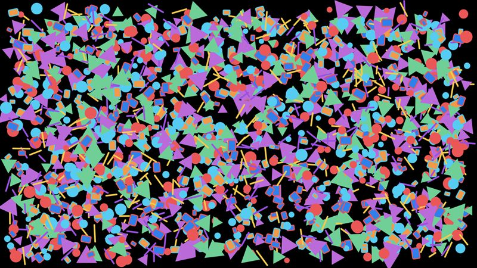
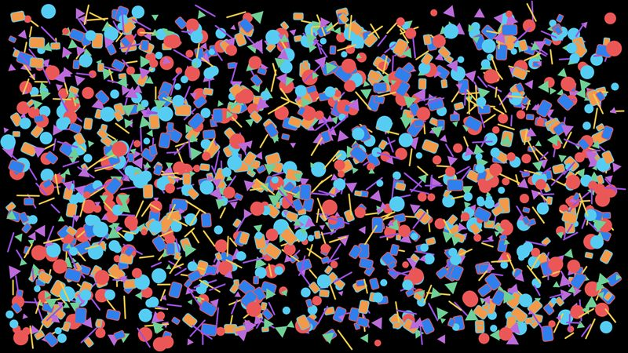

# Shapes

Filled circles, filled rotating rectangles, and a mixed scene of circles, rounded rectangles with a border, thick lines and triangles.

- **Engine side:** `Apos.Shapes`: one `ShapeBatch`, signed-distance-field shapes drawn as instanced quads. The rectangle scenes also run `SpriteBatch` stretching a white pixel, which has aliased edges; the table shows whichever is faster.
- **Skia side:** `SKCanvas.DrawCircle`, `DrawRect`, `DrawRoundRect` (fill and stroke), `DrawLine` and `DrawPath`, anti-aliased. Rotation goes through the canvas matrix.

| Engine | Skia (direct) |
|---|---|
|  |  |

Screenshots: mixed shapes 2k, KNI DesktopGL. The scenes are 1600x900 and animate every frame.

## Results

<!-- results:begin -->

### MonoGame DesktopGL, H2

| Scene | Native frame ms | SkiaGameRendering frame ms | Skia time / Native time |
|---|---:|---:|---:|
| Circles 500 | 0.98 (Apos.Shapes) | 1.22 | 1.24x |
| Circles 2k | 1.78 (Apos.Shapes) | 2.32 | 1.30x |
| Circles 10k | 4.61 (Apos.Shapes) | 9.90 | 2.15x |
| Mixed shapes 2k | 1.84 (Apos.Shapes) | 14.5 | 7.87x |
| Mixed shapes 10k | 6.85 (Apos.Shapes) | 66.7 | 9.73x |

### KNI DesktopGL, H2

| Scene | Native frame ms | SkiaGameRendering frame ms | Skia time / Native time |
|---|---:|---:|---:|
| Circles 500 | 0.61 (Apos.Shapes) | 1.20 | 1.96x |
| Circles 2k | 1.17 (Apos.Shapes) | 2.17 | 1.84x |
| Circles 10k | 3.70 (Apos.Shapes) | 11.0 | 2.97x |
| Mixed shapes 2k | 1.47 (Apos.Shapes) | 14.3 | 9.70x |
| Mixed shapes 10k | 5.88 (Apos.Shapes) | 66.7 | 11.33x |

### KNI WebGL (Chrome), H2

| Scene | Native frame ms | SkiaGameRendering frame ms | Skia time / Native time |
|---|---:|---:|---:|
| Circles 500 | 2.47 (Apos.Shapes) | 1.24 | 0.50x |
| Circles 2k | 9.26 (Apos.Shapes) | 3.10 | 0.33x |
| Circles 10k | 45.5 (Apos.Shapes) | 12.2 | 0.27x |
| Mixed shapes 2k | 13.0 (Apos.Shapes) | 16.9 | 1.31x |
| Mixed shapes 10k | 62.5 (Apos.Shapes) | 76.9 | 1.23x |

<!-- results:end -->

## Reading the numbers

- Desktop: plain circles take 1.2-3.0x as long as `Apos.Shapes`; the mixed scene (strokes, round caps, paths) 7.9-11.3x, because those go through Skia's path rendering instead of a closed-form shader.
- Browser: plain circles take 0.27-0.50x as long, since `Apos.Shapes` builds its vertices in managed WebAssembly. The mixed scene takes 1.2-1.3x as long.

## Stroked rounded rectangles

Measured on H1 (MonoGame DesktopGL, `SkiaDirectCanvas`), 500 rounded rectangles with a 2 px border per frame, draw CPU ms per frame, median [min-max] of 10 runs. Cheaper equivalents exist for the border; the fill is 0.83 ms of each total.

| Border drawn as | Draw CPU ms (500 rectangles) | Faster than default |
|---|---:|---:|
| `DrawRoundRect` with a stroke paint (default miter join) | 7.90 [7.80-8.76] | 1x |
| Same, `SKPaint.StrokeJoin = SKStrokeJoin.Round` | 3.55 [3.36-3.90] | 2.2x |
| Outline path built once with `SKPaint.GetFillPath`, drawn as a fill | 1.97 [1.81-2.55] | 4.0x |

- Gains hold for stroke widths of 1-8 px and rectangles three times larger.
- A pre-built `SKRoundRect`, an `SKPath` rounded rectangle, round caps and Skia context options did not help.
- Circle and oval strokes are cheap (about 1.5 ms draw CPU per 500 with the fill), so it is the rounded-rectangle stroke that is slow.
- The cheaper versions are not pixel-identical: against the default, 63,667 of 684,171 non-black pixels differ in the mixed shapes 2k frame (13 by 100 or more levels, maximum 118), all on border edges.
- 4x MSAA on the back buffer also speeds this up; see issue #265 for the full variant table.
