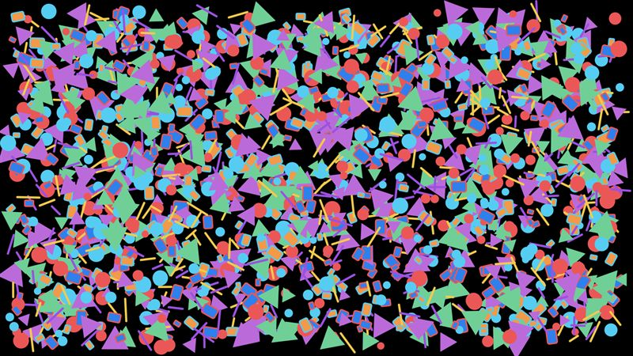
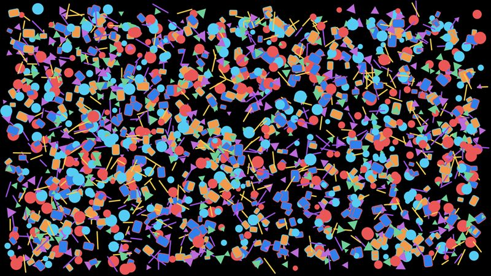

# Shapes

Filled circles, and a mixed scene of circles, rounded rectangles with a border, thick lines and triangles.

- **Engine side:** `Apos.Shapes`: one `ShapeBatch`, signed-distance-field shapes drawn as instanced quads.
- **Skia side:** `SKCanvas.DrawCircle`, `DrawRoundRect` (fill and stroke), `DrawLine` and `DrawPath`, anti-aliased. Rotation goes through the canvas matrix.

| Engine | Skia (direct) |
|---|---|
|  |  |

Screenshots: mixed shapes 2k, KNI DesktopGL. The scenes are 1600x900 and animate every frame.

## Results

<!-- results:begin -->

### MonoGame DesktopGL, H2

| Scene | Native FPS | SkiaGameRendering FPS | SkiaGameRendering / Native |
|---|---:|---:|---:|
| Circles 500 | 1017 (Apos.Shapes) | 820 | 81% |
| Circles 2k | 562 (Apos.Shapes) | 431 | 77% |
| Circles 10k | 217 (Apos.Shapes) | 101 | 47% |
| Mixed shapes 2k | 543 (Apos.Shapes) | 69 | 13% |
| Mixed shapes 10k | 146 (Apos.Shapes) | 15 | 10% |

### KNI DesktopGL, H2

| Scene | Native FPS | SkiaGameRendering FPS | SkiaGameRendering / Native |
|---|---:|---:|---:|
| Circles 500 | 1637 (Apos.Shapes) | 834 | 51% |
| Circles 2k | 852 (Apos.Shapes) | 462 | 54% |
| Circles 10k | 270 (Apos.Shapes) | 91 | 34% |
| Mixed shapes 2k | 679 (Apos.Shapes) | 70 | 10% |
| Mixed shapes 10k | 170 (Apos.Shapes) | 15 | 9% |

### KNI WebGL (Chrome), H2

| Scene | Native FPS | SkiaGameRendering FPS | SkiaGameRendering / Native |
|---|---:|---:|---:|
| Circles 500 | 405 (Apos.Shapes) | 804 | 199% |
| Circles 2k | 108 (Apos.Shapes) | 323 | 299% |
| Circles 10k | 22 (Apos.Shapes) | 82 | 373% |
| Mixed shapes 2k | 77 (Apos.Shapes) | 59 | 77% |
| Mixed shapes 10k | 16 (Apos.Shapes) | 13 | 81% |

<!-- results:end -->

## Reading the numbers

- Desktop: plain circles run at 34-81% of `Apos.Shapes`; the mixed scene (strokes, round caps, paths) at about 10%, because those go through Skia's path rendering instead of a closed-form shader.
- Browser: plain circles run at 199-373%, since `Apos.Shapes` builds its vertices in managed WebAssembly. The mixed scene runs at about 80%.

## Stroked rounded rectangles

Measured on H1 (MonoGame DesktopGL, `SkiaDirectCanvas`), 500 rounded rectangles with a 2 px border per frame, median of 10 runs. Cheaper equivalents exist for the border; the fill is 0.83 ms of each total.

| Border drawn as | ms per 500 | Faster than default |
|---|---:|---:|
| `DrawRoundRect` with a stroke paint (default miter join) | 7.90 [7.80-8.76] | 1x |
| Same, `SKPaint.StrokeJoin = SKStrokeJoin.Round` | 3.55 [3.36-3.90] | 2.2x |
| Outline path built once with `SKPaint.GetFillPath`, drawn as a fill | 1.97 [1.81-2.55] | 4.0x |

- Gains hold for stroke widths of 1-8 px and rectangles three times larger.
- A pre-built `SKRoundRect`, an `SKPath` rounded rectangle, round caps and Skia context options did not help.
- Circle and oval strokes are cheap (about 1.5 ms per 500 with the fill), so it is the rounded-rectangle stroke that is slow.
- The cheaper versions are not pixel-identical: against the default, 63,667 of 684,171 non-black pixels differ in the mixed shapes 2k frame (13 by 100 or more levels, maximum 118), all on border edges.
- 4x MSAA on the back buffer also speeds this up; see issue #265 for the full variant table.
