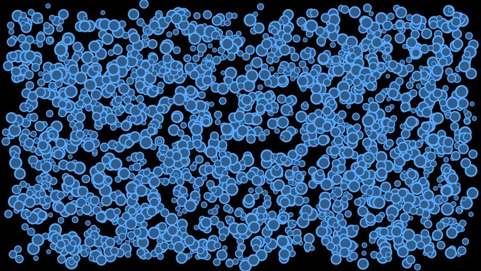
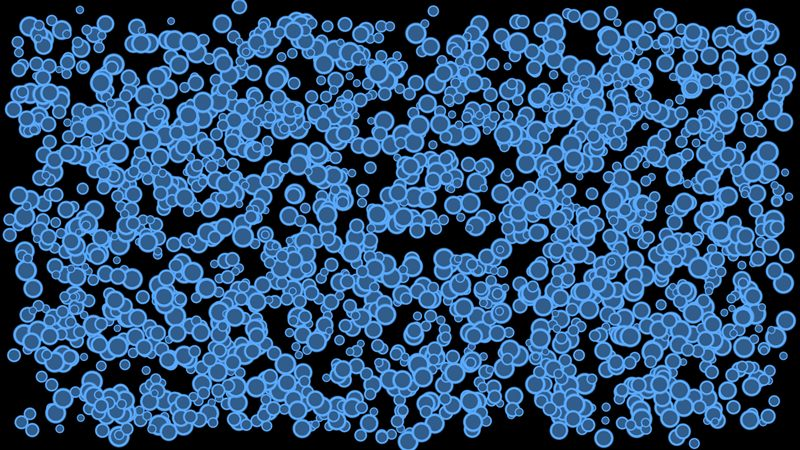

# Sprites, one texture

One 64x64 soft-edged disc, drawn thousands of times with scale, rotation and (in the last scene) a per-sprite tint. This is the case `SpriteBatch` is built for, so it shows the cost of going through Skia when you do not need to.

- **Engine side:** `SpriteBatch.Draw` in one deferred batch.
- **Skia side:** One `DrawAtlas` call on a GPU-resident image, tinted through the `colors` array with `SKBlendMode.Modulate`.

| Engine | Skia (direct) |
|---|---|
|  |  |

Screenshots: 2k sprites, KNI DesktopGL. The scenes are 1600x900 and animate every frame.

## Results

<!-- results:begin -->

### MonoGame DesktopGL, H2

| Scene | Native frame ms | SkiaGameRendering frame ms | Skia time / Native time |
|---|---:|---:|---:|
| Sprites 0 | 0.60 (SpriteBatch) | 0.61 | 1.03x |
| Sprites 500 | 0.70 (SpriteBatch) | 1.06 | 1.52x |
| Sprites 2k | 0.98 (SpriteBatch) | 1.67 | 1.70x |
| Sprites 10k | 3.70 (SpriteBatch) | 3.70 | 1.00x |
| Sprites 50k | 16.1 (SpriteBatch) | 19.2 | 1.19x |
| Tinted sprites 10k | 3.08 (SpriteBatch) | 3.75 | 1.22x |

### KNI DesktopGL, H2

| Scene | Native frame ms | SkiaGameRendering frame ms | Skia time / Native time |
|---|---:|---:|---:|
| Sprites 0 | 0.47 (SpriteBatch) | 0.57 | 1.22x |
| Sprites 500 | 0.51 (SpriteBatch) | 1.05 | 2.05x |
| Sprites 2k | 0.75 (SpriteBatch) | 1.58 | 2.11x |
| Sprites 10k | 2.75 (SpriteBatch) | 4.10 | 1.49x |
| Sprites 50k | 13.2 (SpriteBatch) | 19.2 | 1.46x |
| Tinted sprites 10k | 2.51 (SpriteBatch) | 3.68 | 1.47x |

### KNI WebGL (Chrome), H2

| Scene | Native frame ms | SkiaGameRendering frame ms | Skia time / Native time |
|---|---:|---:|---:|
| Sprites 0 | 0.36 (SpriteBatch) | 0.59 | 1.64x |
| Sprites 500 | 0.66 (SpriteBatch) | 0.72 | 1.09x |
| Sprites 2k | 0.98 (SpriteBatch) | 0.94 | 0.96x |
| Sprites 10k | 4.15 (SpriteBatch) | 3.11 | 0.75x |
| Sprites 50k | 15.2 (SpriteBatch) | 13.9 | 0.92x |
| Tinted sprites 10k | 2.64 (SpriteBatch) | 2.87 | 1.09x |

<!-- results:end -->

## Reading the numbers

- Desktop: Skia takes 1.0-2.1x as long as `SpriteBatch`, worst at 500-2k sprites, where Skia's fixed cost per frame (context switch and flush, about 0.1 ms) is a large share of a short frame.
- Browser: roughly even from 500 sprites up (0.75-1.09x).
- Tinting through `DrawAtlas`'s `colors` costs almost nothing.

## Faster: one `DrawAtlas`, not one call per sprite

MonoGame DesktopGL, `SkiaDirectCanvas`, 1600x900, H1 (Ryzen 7 260, RTX 5060 Laptop, driver 32.0.16.1047). Draw CPU ms per frame, median [min-max] of 6 runs (`--quick` windows), same scene and sprites in every row.

| Scene | `DrawAtlas` (one call), draw CPU ms | `DrawImageRect` per sprite, draw CPU ms | `DrawImage` per sprite, draw CPU ms | Per-sprite / `DrawAtlas` time |
|---|---:|---:|---:|---:|
| Sprites 500 | 0.22 [0.19-0.36] | 0.61 [0.57-0.66] | 0.59 [0.56-0.67] | 2.7x |
| Sprites 2k | 0.29 [0.26-0.40] | 2.16 [1.79-3.24] | 1.92 [1.76-2.25] | 6.5x-7.4x |
| Sprites 10k | 1.05 [0.61-1.44] | 10.1 [9.1-14.7] | 10.1 [9.2-16.3] | 9.6x |
| Sprites 50k | 4.0 [3.9-4.6] | 49 [45-80] | 47 [46-60] | 11.7x-12.2x |
| Tinted sprites 10k | 0.94 [0.85-1.04] | 10.0 [8.9-14.6] | 10.7 [9.0-13.7] | 10.7x-11.4x |

Each per-sprite call sets the canvas matrix to the sprite's rotation and scale first. Use `DrawAtlas` with one `SKRotationScaleMatrix` per sprite, as the Skia scene here does.

Tried and no gain beyond the noise on the `DrawAtlas` path:

- `SKFilterMode.Nearest` instead of `Linear`: 0.27 vs 0.29 ms at 2k, 0.97 vs 1.05 ms at 10k, but the runs overlap (2k `DrawAtlas` ranged 0.26-0.40), and 50k and tinted 10k went the other way.
- Passing no `SKPaint` (`null`) instead of a reused one: within 5% at every count, runs overlap.

Output is not claimed to be identical between the atlas and per-sprite paths, so the speedup applies to sprites you would draw with the same filtering either way.
