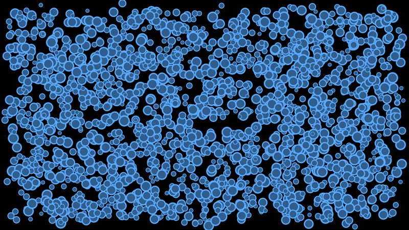
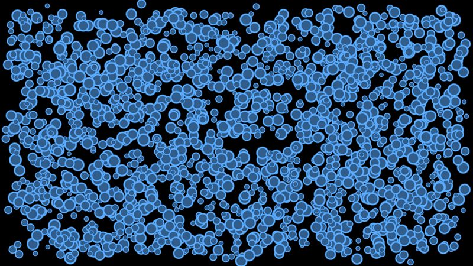

# Sprites, one texture

One 64x64 soft-edged disc, drawn thousands of times with scale, rotation and (in the last scene) a per-sprite tint. This is the case `SpriteBatch` is built for, so it shows the cost of going through Skia when you do not need to.

- **Engine side:** `SpriteBatch.Draw` in one deferred batch.
- **Skia side:** One `DrawAtlas` call on a GPU-resident image, tinted through the `colors` array with `SKBlendMode.Modulate`.

| Engine | Skia (direct) |
|---|---|
|  |  |

Screenshots: 2k sprites, KNI DesktopGL. The scenes are 1600x900 and animate every frame.

## Results

<!-- results:begin -->

### MonoGame DesktopGL, H2

| Scene | Native FPS | SkiaGameRendering FPS | Change |
|---|---:|---:|---:|
| Sprites 0 | 1680 (SpriteBatch) | 1634 | -3% |
| Sprites 500 | 1433 (SpriteBatch) | 941 | -34% |
| Sprites 2k | 1021 (SpriteBatch) | 600 | -41% |
| Sprites 10k | 270 (SpriteBatch) | 270 | +0% |
| Sprites 50k | 62 (SpriteBatch) | 52 | -16% |
| Tinted sprites 10k | 325 (SpriteBatch) | 267 | -18% |

### KNI DesktopGL, H2

| Scene | Native FPS | SkiaGameRendering FPS | Change |
|---|---:|---:|---:|
| Sprites 0 | 2132 (SpriteBatch) | 1741 | -18% |
| Sprites 500 | 1945 (SpriteBatch) | 949 | -51% |
| Sprites 2k | 1335 (SpriteBatch) | 633 | -53% |
| Sprites 10k | 364 (SpriteBatch) | 244 | -33% |
| Sprites 50k | 76 (SpriteBatch) | 52 | -32% |
| Tinted sprites 10k | 399 (SpriteBatch) | 272 | -32% |

### KNI WebGL (Chrome), H2

| Scene | Native FPS | SkiaGameRendering FPS | Change |
|---|---:|---:|---:|
| Sprites 0 | 2759 (SpriteBatch) | 1689 | -39% |
| Sprites 500 | 1522 (SpriteBatch) | 1393 | -8% |
| Sprites 2k | 1025 (SpriteBatch) | 1064 | +4% |
| Sprites 10k | 241 (SpriteBatch) | 322 | +34% |
| Sprites 50k | 66 (SpriteBatch) | 72 | +9% |
| Tinted sprites 10k | 379 (SpriteBatch) | 348 | -8% |

<!-- results:end -->

## Reading the numbers

- Desktop: Skia is 0-53% slower than `SpriteBatch`. The gap is widest at 500-2k sprites, where Skia's fixed cost per frame (context switch and flush, about 0.1 ms) is a large share of a short frame.
- Browser: roughly even from 500 sprites up.
- Tinting through `DrawAtlas`'s `colors` costs almost nothing.
