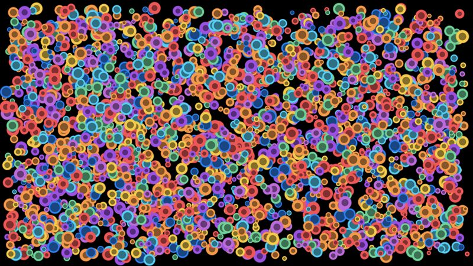
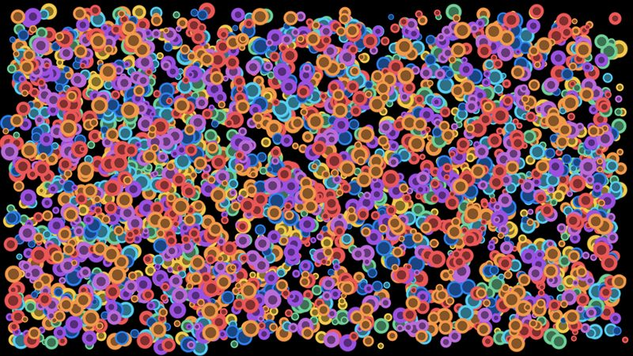

# Sprites, ten textures

Sprite `i` uses texture `i % 10`, so the draw order is texture 1, 2, ..., 10, then 1, 2, ... again. Nothing is random, so every run and platform draws the same thing. A game that draws in submission order pays for a texture change on almost every sprite.

- **Engine side:** `SpriteBatch` in submission order (`SpriteSortMode.Deferred`), and again sorted by texture (`SpriteSortMode.Texture`), which batches each texture's sprites.
- **Skia side:** One `DrawAtlas` call per texture (ten calls), each drawing every tenth sprite. That changes the draw order among sprites, as sorting by texture does.

| Engine | Skia (direct) |
|---|---|
|  |  |

Screenshots: 3k sprites, KNI DesktopGL. The scenes are 1600x900 and animate every frame.

## Results

<!-- results:begin -->

### MonoGame DesktopGL, H2

| Scene | Native FPS | SkiaGameRendering FPS | Change |
|---|---:|---:|---:|
| Textures 0 | 2698 (SpriteBatch (sorted by texture)) | 1668 | -38% |
| Textures 300 | 1447 (SpriteBatch (in order)) | 1010 | -30% |
| Textures 3k | 606 (SpriteBatch (sorted by texture)) | 491 | -19% |
| Textures 30k | 110 (SpriteBatch (sorted by texture)) | 65 | -41% |

### KNI DesktopGL, H2

| Scene | Native FPS | SkiaGameRendering FPS | Change |
|---|---:|---:|---:|
| Textures 0 | 3062 (SpriteBatch (sorted by texture)) | 1695 | -45% |
| Textures 300 | 2111 (SpriteBatch (sorted by texture)) | 1027 | -51% |
| Textures 3k | 949 (SpriteBatch (sorted by texture)) | 480 | -49% |
| Textures 30k | 124 (SpriteBatch (sorted by texture)) | 58 | -53% |

### KNI WebGL (Chrome), H2

| Scene | Native FPS | SkiaGameRendering FPS | Change |
|---|---:|---:|---:|
| Textures 0 | 2806 (SpriteBatch (sorted by texture)) | 1677 | -40% |
| Textures 300 | 3069 (SpriteBatch (sorted by texture)) | 1434 | -53% |
| Textures 3k | 534 (SpriteBatch (sorted by texture)) | 848 | +59% |
| Textures 30k | 111 (SpriteBatch (sorted by texture)) | 117 | +5% |

<!-- results:end -->

## Reading the numbers

- Native is `SpriteBatch` sorted by texture, its best case. Skia, one `DrawAtlas` per texture, is 19-53% slower on the desktop.
- Browser: Skia is 59% faster at 3k sprites and even at 30k.
- `SpriteBatch` in submission order (not in the table) collapses with many texture changes: 21 FPS at 30k sprites on KNI DesktopGL, 2 FPS in the browser.
