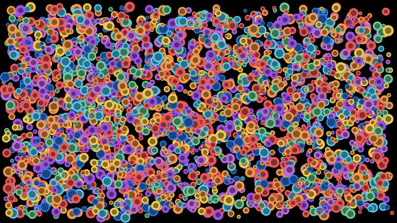
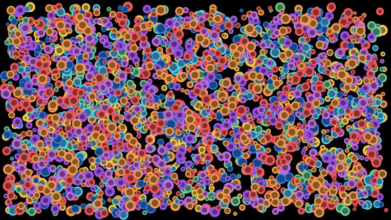

# Sprites, ten textures

Sprite `i` uses texture `i % 10`, so the draw order is texture 1, 2, ..., 10, then 1, 2, ... again. Nothing is random, so every run and platform draws the same thing. A game that draws in submission order pays for a texture change on almost every sprite.

- **Engine side:** `SpriteBatch` in submission order (`SpriteSortMode.Deferred`), and again sorted by texture (`SpriteSortMode.Texture`), which batches each texture's sprites.
- **Skia side:** One `DrawAtlas` call per texture (ten calls), each drawing every tenth sprite. That changes the draw order among sprites, as sorting by texture does.

| Engine | Skia (direct) |
|---|---|
|  |  |

Screenshots: 3k sprites, KNI DesktopGL. The scenes are 1600x900 and animate every frame.

## Results

<!-- results:begin -->

### MonoGame DesktopGL, H2

| Scene | Native frame ms | SkiaGameRendering frame ms | Skia time / Native time |
|---|---:|---:|---:|
| Textures 0 | 0.37 (SpriteBatch (sorted by texture)) | 0.60 | 1.62x |
| Textures 300 | 0.69 (SpriteBatch (in order)) | 0.99 | 1.43x |
| Textures 3k | 1.65 (SpriteBatch (sorted by texture)) | 2.04 | 1.23x |
| Textures 30k | 9.09 (SpriteBatch (sorted by texture)) | 15.4 | 1.69x |

### KNI DesktopGL, H2

| Scene | Native frame ms | SkiaGameRendering frame ms | Skia time / Native time |
|---|---:|---:|---:|
| Textures 0 | 0.33 (SpriteBatch (sorted by texture)) | 0.59 | 1.80x |
| Textures 300 | 0.47 (SpriteBatch (sorted by texture)) | 0.97 | 2.05x |
| Textures 3k | 1.05 (SpriteBatch (sorted by texture)) | 2.08 | 1.98x |
| Textures 30k | 8.07 (SpriteBatch (sorted by texture)) | 17.2 | 2.14x |

### KNI WebGL (Chrome), H2

| Scene | Native frame ms | SkiaGameRendering frame ms | Skia time / Native time |
|---|---:|---:|---:|
| Textures 0 | 0.36 (SpriteBatch (sorted by texture)) | 0.60 | 1.67x |
| Textures 300 | 0.33 (SpriteBatch (sorted by texture)) | 0.70 | 2.14x |
| Textures 3k | 1.87 (SpriteBatch (sorted by texture)) | 1.18 | 0.63x |
| Textures 30k | 9.01 (SpriteBatch (sorted by texture)) | 8.55 | 0.95x |

<!-- results:end -->

## Reading the numbers

- Native is the faster `SpriteBatch` order, almost always sorted by texture, its best case. Skia, one `DrawAtlas` per texture, takes 1.2-2.1x as long on the desktop.
- Browser: Skia takes 0.63x as long at 3k sprites and 0.95x at 30k.
- `SpriteBatch` in submission order (not in the table) collapses with many texture changes: 47.6 ms per frame at 30k sprites on KNI DesktopGL, 500 ms in the browser.
