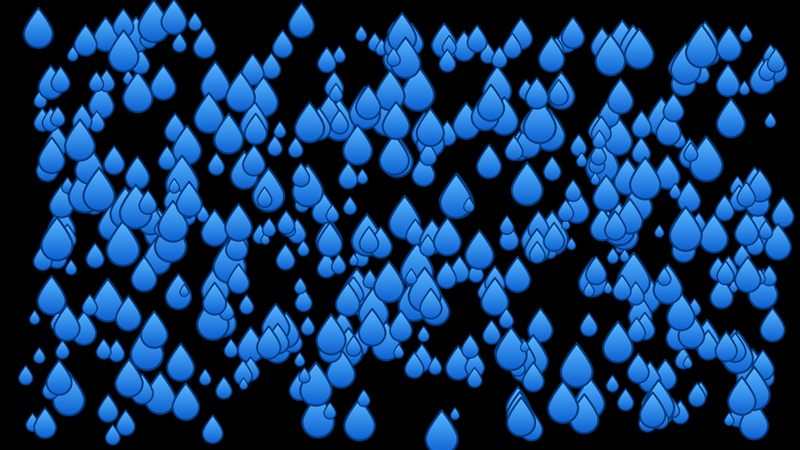
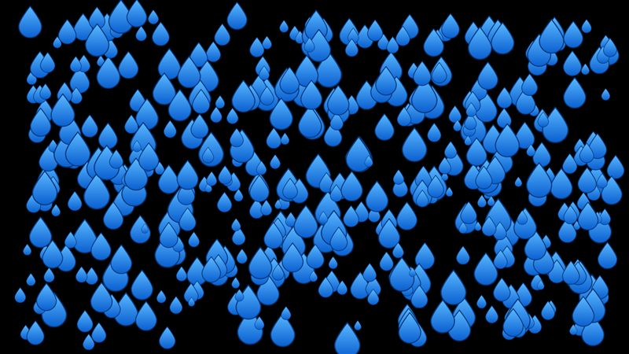

# SVG

The drop icon from `samples/Shared/Drop.svg` (a path with a linear gradient and a stroke), drawn at 24 to 96 px as vectors on every frame.

- **Engine side:** `Apos.Shapes` `ShapeBatch.DrawSvg` on a parsed `ShapeSvg`.
- **Skia side:** `Svg.Skia` parses the file to an `SKPicture`; every frame replays it with `DrawPicture`.

| Engine | Skia (direct) |
|---|---|
|  |  |

Screenshots: 500 drops, KNI DesktopGL. The scenes are 1600x900 and animate every frame.

## Results

<!-- results:begin -->

### MonoGame DesktopGL, H2

| Scene | Native frame ms | SkiaGameRendering frame ms | Skia time / Native time |
|---|---:|---:|---:|
| SVG 100 | 1.53 (Apos.Shapes SVG) | 13.5 | 8.85x |
| SVG 500 | 6.94 (Apos.Shapes SVG) | 55.6 | 8.00x |
| SVG 2k | 26.3 (Apos.Shapes SVG) | 250.0 | 9.50x |

### KNI DesktopGL, H2

| Scene | Native frame ms | SkiaGameRendering frame ms | Skia time / Native time |
|---|---:|---:|---:|
| SVG 100 | 1.53 (Apos.Shapes SVG) | 13.7 | 8.97x |
| SVG 500 | 6.21 (Apos.Shapes SVG) | 55.6 | 8.94x |
| SVG 2k | 31.3 (Apos.Shapes SVG) | 250.0 | 8.00x |

### KNI WebGL (Chrome), H2

| Scene | Native frame ms | SkiaGameRendering frame ms | Skia time / Native time |
|---|---:|---:|---:|
| SVG 100 | 4.67 (Apos.Shapes SVG) | 2.83 | 0.60x |
| SVG 500 | 20.4 (Apos.Shapes SVG) | 13.7 | 0.67x |
| SVG 2k | 76.9 (Apos.Shapes SVG) | 40.0 | 0.52x |

<!-- results:end -->

## Reading the numbers

- Desktop: Skia takes 8.0-9.5x as long. Its path and stroke tessellation is what costs.
- Browser: Skia takes 0.52-0.67x as long, for the same reason as the shapes page.
