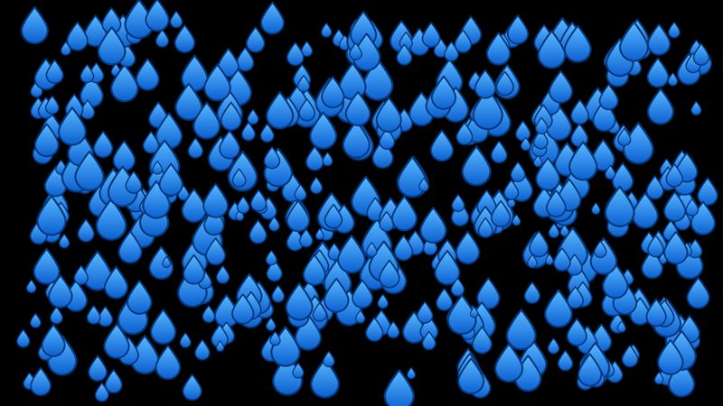
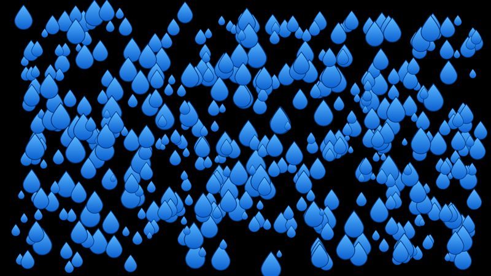

# SVG

The drop icon from `samples/Shared/Drop.svg` (a path with a linear gradient and a stroke), drawn at 24 to 96 px as vectors on every frame.

- **Engine side:** `Apos.Shapes` `ShapeBatch.DrawSvg` on a parsed `ShapeSvg`.
- **Skia side:** `Svg.Skia` parses the file to an `SKPicture`; every frame replays it with `DrawPicture`.

| Engine | Skia (direct) |
|---|---|
|  |  |

Screenshots: 500 drops, KNI DesktopGL. The scenes are 1600x900 and animate every frame.

## Results

<!-- results:begin -->

### MonoGame DesktopGL, H2

| Scene | Native FPS | SkiaGameRendering FPS | Change |
|---|---:|---:|---:|
| SVG 100 | 655 (Apos.Shapes SVG) | 74 | -89% |
| SVG 500 | 144 (Apos.Shapes SVG) | 18 | -88% |
| SVG 2k | 38 (Apos.Shapes SVG) | 4 | -89% |

### KNI DesktopGL, H2

| Scene | Native FPS | SkiaGameRendering FPS | Change |
|---|---:|---:|---:|
| SVG 100 | 655 (Apos.Shapes SVG) | 73 | -89% |
| SVG 500 | 161 (Apos.Shapes SVG) | 18 | -89% |
| SVG 2k | 32 (Apos.Shapes SVG) | 4 | -88% |

### KNI WebGL (Chrome), H2

| Scene | Native FPS | SkiaGameRendering FPS | Change |
|---|---:|---:|---:|
| SVG 100 | 214 (Apos.Shapes SVG) | 354 | +65% |
| SVG 500 | 49 (Apos.Shapes SVG) | 73 | +49% |
| SVG 2k | 13 (Apos.Shapes SVG) | 25 | +92% |

<!-- results:end -->

## Reading the numbers

- Desktop: Skia is about 89% slower. Its path and stroke tessellation is what costs.
- Browser: Skia is 49-92% faster, for the same reason as the shapes page.
