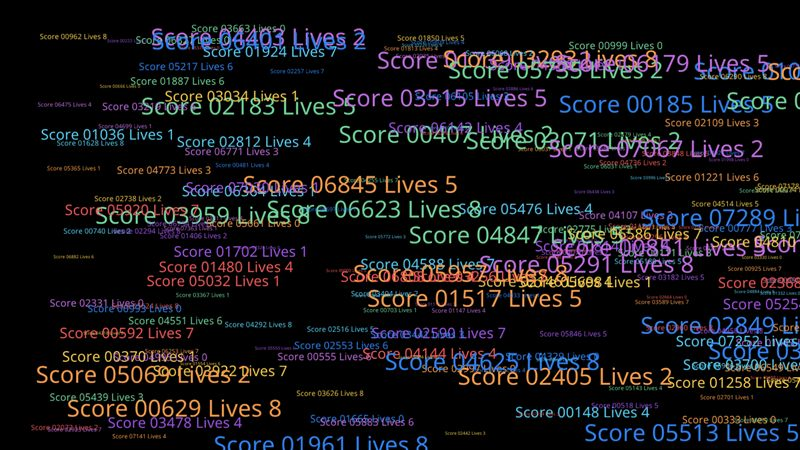
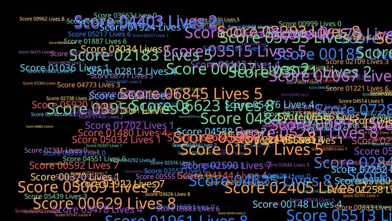

# Text, mixed fonts

The same labels at six sizes (12 to 64 px), so a game needs a font at each size.

- **Engine side:** A `SpriteFont` baked per size (six atlases), and FontStashSharp, which rasterizes each size on demand.
- **Skia side:** One `SKFont` per size, `DrawText` per label.

| Engine | Skia (direct) |
|---|---|
|  |  |

Screenshots: 200 labels, KNI DesktopGL. The scenes are 1600x900 and animate every frame.

## Results

<!-- results:begin -->

### MonoGame DesktopGL, H2

| Scene | Native FPS | SkiaGameRendering FPS | SkiaGameRendering / Native |
|---|---:|---:|---:|
| Mixed text 50 | 1606 (FontStashSharp) | 1019 | 63% |
| Mixed text 200 | 1381 (FontStashSharp) | 690 | 50% |
| Mixed text 1k | 810 (FontStashSharp) | 164 | 20% |

### KNI DesktopGL, H2

| Scene | Native FPS | SkiaGameRendering FPS | SkiaGameRendering / Native |
|---|---:|---:|---:|
| Mixed text 50 | 2535 (FontStashSharp) | 1001 | 39% |
| Mixed text 200 | 2037 (FontStashSharp) | 674 | 33% |
| Mixed text 1k | 945 (FontStashSharp) | 167 | 18% |

### KNI WebGL (Chrome), H2

| Scene | Native FPS | SkiaGameRendering FPS | SkiaGameRendering / Native |
|---|---:|---:|---:|
| Mixed text 50 | 1874 (FontStashSharp) | 1128 | 60% |
| Mixed text 200 | 886 (FontStashSharp) | 615 | 69% |
| Mixed text 1k | 257 (FontStashSharp) | 157 | 61% |

<!-- results:end -->

## Reading the numbers

- Native is FontStashSharp, which packs every size into shared atlases. Skia runs at 18-63% of it on the desktop and 60-69% in the browser, dropping with the label count.
