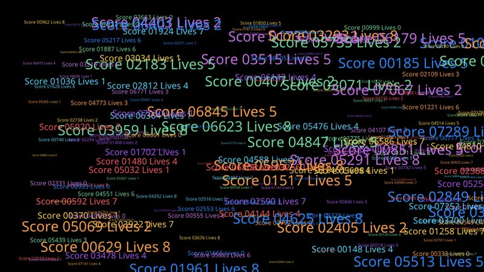
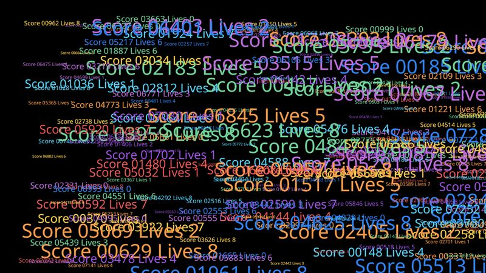

# Text, mixed fonts

The same labels at six sizes (12 to 64 px), so a game needs a font at each size.

- **Engine side:** A `SpriteFont` baked per size (six atlases), and FontStashSharp, which rasterizes each size on demand.
- **Skia side:** One `SKFont` per size, `DrawText` per label.

| Engine | Skia (direct) |
|---|---|
|  |  |

Screenshots: 200 labels, KNI DesktopGL. The scenes are 1600x900 and animate every frame.

## Results

<!-- results:begin -->

### MonoGame DesktopGL, H2

| Scene | Native frame ms | SkiaGameRendering frame ms | Skia time / Native time |
|---|---:|---:|---:|
| Mixed text 50 | 0.62 (FontStashSharp) | 0.98 | 1.57x |
| Mixed text 200 | 0.72 (FontStashSharp) | 1.45 | 2.00x |
| Mixed text 1k | 1.24 (FontStashSharp) | 6.10 | 4.94x |

### KNI DesktopGL, H2

| Scene | Native frame ms | SkiaGameRendering frame ms | Skia time / Native time |
|---|---:|---:|---:|
| Mixed text 50 | 0.39 (FontStashSharp) | 1.00 | 2.54x |
| Mixed text 200 | 0.49 (FontStashSharp) | 1.48 | 3.02x |
| Mixed text 1k | 1.06 (FontStashSharp) | 5.99 | 5.66x |

### KNI WebGL (Chrome), H2

| Scene | Native frame ms | SkiaGameRendering frame ms | Skia time / Native time |
|---|---:|---:|---:|
| Mixed text 50 | 0.53 (FontStashSharp) | 0.89 | 1.66x |
| Mixed text 200 | 1.13 (FontStashSharp) | 1.63 | 1.44x |
| Mixed text 1k | 3.89 (FontStashSharp) | 6.37 | 1.64x |

<!-- results:end -->

## Reading the numbers

- Native is FontStashSharp, which packs every size into shared atlases. Skia takes 1.6-5.7x as long on the desktop, rising with the label count, and 1.4-1.7x in the browser.
