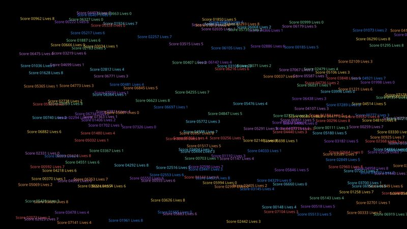
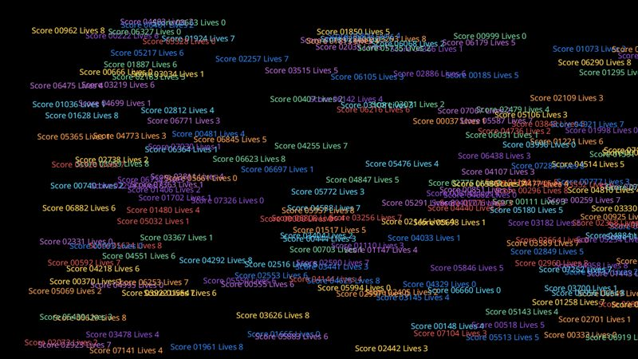

# Text, one font

Labels of about 24 characters in one 20 px font, from Noto Sans.

- **Engine side:** A `SpriteFont` baked at run time from the TTF (a fixed-size glyph atlas, as the content pipeline would build), and FontStashSharp (dynamic sizes, glyphs rasterized on demand).
- **Skia side:** `SKFont` and `SKCanvas.DrawText`, one call per label.

| Engine | Skia (direct) |
|---|---|
|  |  |

Screenshots: 200 labels, KNI DesktopGL. The scenes are 1600x900 and animate every frame.

## Results

<!-- results:begin -->

### MonoGame DesktopGL, H2

| Scene | Native frame ms | SkiaGameRendering frame ms | Skia time / Native time |
|---|---:|---:|---:|
| Text 50 | 0.60 (SpriteFont) | 0.98 | 1.64x |
| Text 200 | 0.61 (FontStashSharp) | 1.49 | 2.43x |
| Text 1k | 0.92 (SpriteFont) | 5.03 | 5.49x |

### KNI DesktopGL, H2

| Scene | Native frame ms | SkiaGameRendering frame ms | Skia time / Native time |
|---|---:|---:|---:|
| Text 50 | 0.38 (FontStashSharp) | 0.95 | 2.51x |
| Text 200 | 0.44 (SpriteFont) | 1.34 | 3.07x |
| Text 1k | 0.72 (SpriteFont) | 5.26 | 7.28x |

### KNI WebGL (Chrome), H2

| Scene | Native frame ms | SkiaGameRendering frame ms | Skia time / Native time |
|---|---:|---:|---:|
| Text 50 | 0.47 (FontStashSharp) | 0.92 | 1.95x |
| Text 200 | 0.66 (SpriteFont) | 1.64 | 2.49x |
| Text 1k | 1.97 (SpriteFont) | 6.17 | 3.14x |

<!-- results:end -->

## Reading the numbers

- Skia takes 1.6-7.3x as long as the faster of `SpriteFont` and FontStashSharp on the desktop, and 2.0-3.1x in the browser, rising with the label count.
- Skia draws text at any size with no atlas to bake; see the mixed-fonts page.

## Faster: batch labels into one text blob

Measured on H1 (Ryzen 7 260, RTX 5060 Laptop, driver 32.0.16.1047), MonoGame DesktopGL, Skia direct, same scenes as above, 6 interleaved runs per variant (`--quick` windows). The runs recorded frame rates, so the frame ms below are 1000 divided by the median frame rate. These are not comparable with the H2 tables above.

| Scene | `DrawText` per label, frame ms | One `SKTextBlob` per label, cached, frame ms | All labels in one positioned blob, frame ms | Batched / per-label time |
|---|---:|---:|---:|---:|
| Text 50 | 0.64 | 0.68 | 0.43 | 0.68x |
| Text 200 | 1.28 | 1.22 | 0.74 | 0.58x |
| Text 1k | 4.50 | 3.14 | 1.58 | 0.35x |

At 1k labels, draw CPU is 4.36, 2.97 and 1.51 ms per frame for the three ways, and the batched frame (1.58 ms) is shorter than native FontStashSharp's on the same machine (2.0 ms).

- Build one `SKTextBlobBuilder` run per frame (`AllocatePositionedRun`), fill each glyph's position as the label origin plus the running glyph advance, and issue a single `DrawText(blob, 0, 0, paint)`. A blob has one paint, so batch per color.
- Caching a blob per label (static text drawn at a moving position) helps only at large counts and costs a little at 50.
- Output is unchanged: `BatchedTextEquivalenceTests` renders both ways and compares every pixel.
- No effect (within noise, 7 runs): `SKFont` `Edging` (`Alias`, `Antialias`), `Subpixel`, `Hinting`, `LinearMetrics`, `BaselineSnap`.
- Not measured: a prebuilt `SKPicture`, `GlyphCacheTextureMaximumBytes`, per-label colors in one blob.
