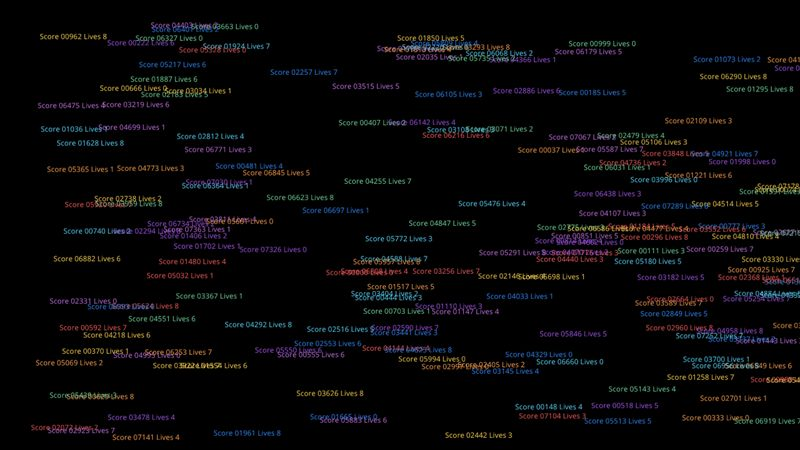
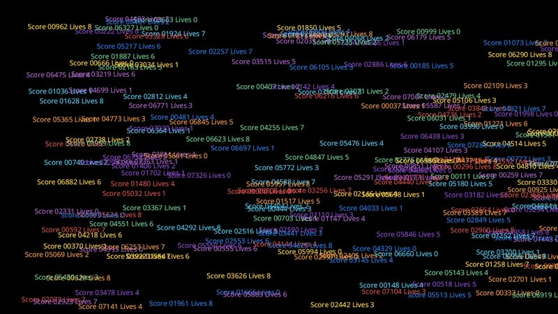

# Text, one font

Labels of about 24 characters in one 20 px font, from Noto Sans.

- **Engine side:** A `SpriteFont` baked at run time from the TTF (a fixed-size glyph atlas, as the content pipeline would build), and FontStashSharp (dynamic sizes, glyphs rasterized on demand).
- **Skia side:** `SKFont` and `SKCanvas.DrawText`, one call per label.

| Engine | Skia (direct) |
|---|---|
|  |  |

Screenshots: 200 labels, KNI DesktopGL. The scenes are 1600x900 and animate every frame.

## Results

<!-- results:begin -->

### MonoGame DesktopGL, H2

| Scene | Native FPS | SkiaGameRendering FPS | SkiaGameRendering / Native |
|---|---:|---:|---:|
| Text 50 | 1679 (SpriteFont) | 1026 | 61% |
| Text 200 | 1636 (FontStashSharp) | 673 | 41% |
| Text 1k | 1093 (SpriteFont) | 199 | 18% |

### KNI DesktopGL, H2

| Scene | Native FPS | SkiaGameRendering FPS | SkiaGameRendering / Native |
|---|---:|---:|---:|
| Text 50 | 2641 (FontStashSharp) | 1053 | 40% |
| Text 200 | 2295 (SpriteFont) | 747 | 33% |
| Text 1k | 1383 (SpriteFont) | 190 | 14% |

### KNI WebGL (Chrome), H2

| Scene | Native FPS | SkiaGameRendering FPS | SkiaGameRendering / Native |
|---|---:|---:|---:|
| Text 50 | 2112 (FontStashSharp) | 1082 | 51% |
| Text 200 | 1520 (SpriteFont) | 611 | 40% |
| Text 1k | 509 (SpriteFont) | 162 | 32% |

<!-- results:end -->

## Reading the numbers

- Skia runs at 14-61% of the faster of `SpriteFont` and FontStashSharp on the desktop, and 32-51% in the browser, dropping with the label count.
- Skia draws text at any size with no atlas to bake; see the mixed-fonts page.

## Faster: batch labels into one text blob

Measured on H1 (Ryzen 7 260, RTX 5060 Laptop, driver 32.0.16.1047), MonoGame DesktopGL, Skia direct, same scenes as above, 6 interleaved runs per variant (`--quick` windows), median FPS [min-max]. These are not comparable with the H2 tables above.

| Scene | `DrawText` per label | One `SKTextBlob` per label, cached | All labels in one positioned blob | Batched / per label |
|---|---:|---:|---:|---:|
| Text 50 | 1574 [1500-1600] | 1471 | 2308 | 1.5x |
| Text 200 | 782 | 821 | 1351 | 1.7x |
| Text 1k | 222 | 318 | 632 | 2.8x |

Draw CPU for Text 1k: 4.36 ms, 2.97 ms, 1.51 ms. At 1k labels the batched version is above the native FontStashSharp figure measured on the same machine (500 FPS).

- Build one `SKTextBlobBuilder` run per frame (`AllocatePositionedRun`), fill each glyph's position as the label origin plus the running glyph advance, and issue a single `DrawText(blob, 0, 0, paint)`. A blob has one paint, so batch per color.
- Caching a blob per label (static text drawn at a moving position) helps only at large counts and costs a little at 50.
- Output is unchanged: `BatchedTextEquivalenceTests` renders both ways and compares every pixel.
- No effect (within noise, 7 runs): `SKFont` `Edging` (`Alias`, `Antialias`), `Subpixel`, `Hinting`, `LinearMetrics`, `BaselineSnap`.
- Not measured: a prebuilt `SKPicture`, `GlyphCacheTextureMaximumBytes`, per-label colors in one blob.
