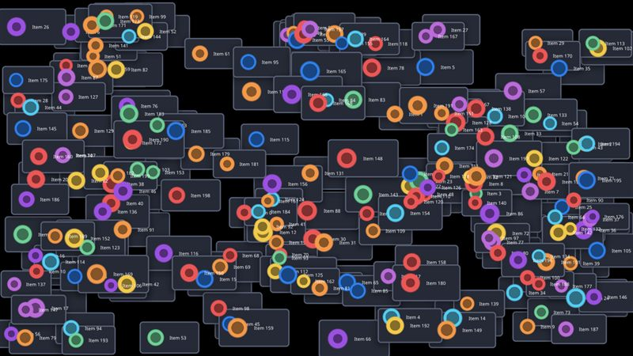
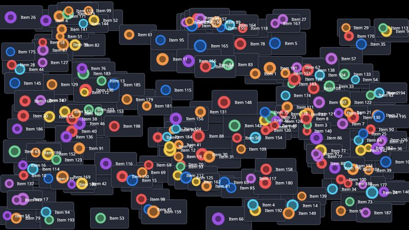

# UI panels

What a game UI draws: cards with a drop shadow, a rounded body and a border, an icon and a line of text each.

- **Engine side:** `Apos.Shapes` for the shadow and card, then `SpriteBatch` for the icon and the `SpriteFont` text. Each card draws completely before the next, as a real UI does, so every card ends one batch of each.
- **Skia side:** Everything on one canvas, one card at a time: shadow and card with `DrawRoundRect`, the icon with `DrawImage`, the text with `DrawText`.

| Engine | Skia (direct) |
|---|---|
|  |  |

Screenshots: 200 cards, KNI DesktopGL, from before the scenes drew one card at a time. The scenes are 1600x900 and animate every frame.

## Results

<!-- results:begin -->

### MonoGame DesktopGL, H2

| Scene | Native frame ms | SkiaGameRendering frame ms | Skia time / Native time |
|---|---:|---:|---:|
| UI 50 | 3.14 (Apos.Shapes + SpriteBatch) | 1.26 | 0.40x |
| UI 200 | 4.65 (Apos.Shapes + SpriteBatch) | 2.67 | 0.57x |
| UI 1k | 25.0 (Apos.Shapes + SpriteBatch) | 12.8 | 0.51x |

### KNI DesktopGL, H2

| Scene | Native frame ms | SkiaGameRendering frame ms | Skia time / Native time |
|---|---:|---:|---:|
| UI 50 | 1.54 (Apos.Shapes + SpriteBatch) | 1.38 | 0.90x |
| UI 200 | 8.70 (Apos.Shapes + SpriteBatch) | 2.67 | 0.31x |
| UI 1k | 15.9 (Apos.Shapes + SpriteBatch) | 14.1 | 0.89x |

### KNI WebGL (Chrome), H2

| Scene | Native frame ms | SkiaGameRendering frame ms | Skia time / Native time |
|---|---:|---:|---:|
| UI 200 | 41.7 (Apos.Shapes + SpriteBatch) | 3.77 | 0.09x |
| UI 1k | 200.0 (Apos.Shapes + SpriteBatch) | 14.1 | 0.07x |

<!-- results:end -->

## Reading the numbers

These results were measured when the cards drew in batches (every panel, then every icon, then every label). They change at the next docs regeneration.

- Desktop: Skia takes 0.31-0.90x as long. Skia draws everything in one pass, where the engine side needs `Apos.Shapes` and a second `SpriteBatch`, and on MonoGame DesktopGL the engine side stalls often (its 95th-percentile frame is 10-14 times its median).
- Browser: Skia takes under 0.1x as long, since `Apos.Shapes` and `SpriteBatch` are CPU-bound in WebAssembly. The engine's 50-card browser run is missing (it stalled for a minute), so that row is left out.
