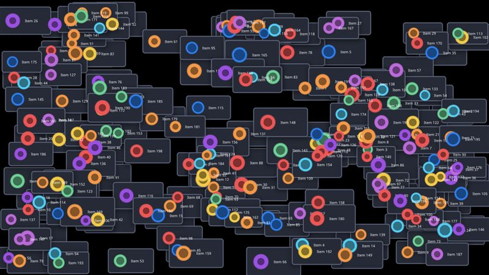
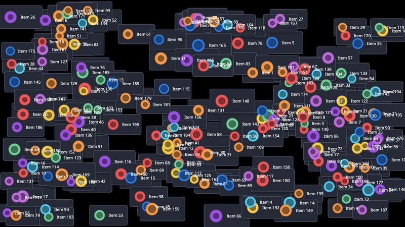

# UI panels

What a game UI draws: cards with a drop shadow, a rounded body and a border, an icon and a line of text each.

- **Engine side:** `Apos.Shapes` for the shadow and card, then `SpriteBatch` for the icon and the `SpriteFont` text. Each card draws completely before the next, as a real UI does, so every card ends one batch of each.
- **Skia side:** Everything on one canvas, one card at a time: shadow and card with `DrawRoundRect`, the icon with `DrawImage`, the text with `DrawText`.

| Engine | Skia (direct) |
|---|---|
|  |  |

Screenshots: 200 cards, KNI DesktopGL, from before the scenes drew one card at a time. The scenes are 1600x900 and animate every frame.

## Results

<!-- results:begin -->

### MonoGame DesktopGL, H2

| Scene | Native FPS | SkiaGameRendering FPS | SkiaGameRendering / Native |
|---|---:|---:|---:|
| UI 50 | 319 (Apos.Shapes + SpriteBatch) | 796 | 250% |
| UI 1k | 40 (Apos.Shapes + SpriteBatch) | 78 | 195% |

### KNI DesktopGL, H2

| Scene | Native FPS | SkiaGameRendering FPS | SkiaGameRendering / Native |
|---|---:|---:|---:|
| UI 50 | 649 (Apos.Shapes + SpriteBatch) | 723 | 111% |
| UI 1k | 63 (Apos.Shapes + SpriteBatch) | 71 | 113% |

### KNI WebGL (Chrome), H2

| Scene | Native FPS | SkiaGameRendering FPS | SkiaGameRendering / Native |
|---|---:|---:|---:|
| UI 1k | 5 (Apos.Shapes + SpriteBatch) | 71 | 1420% |

<!-- results:end -->

## Reading the numbers

These results were measured when the cards drew in batches (every panel, then every icon, then every label). They change at the next docs regeneration.

- Desktop: Skia runs at 111-250%. Skia draws everything in one pass, where the engine side needs `Apos.Shapes` and a second `SpriteBatch`, and on MonoGame DesktopGL the engine side stalls often (its 95th-percentile frame is 10-14 times its median).
- Browser: Skia runs at over 1000%, since `Apos.Shapes` and `SpriteBatch` are CPU-bound in WebAssembly. The engine's 50-card browser run is missing (it stalled for a minute), so that row is left out.
