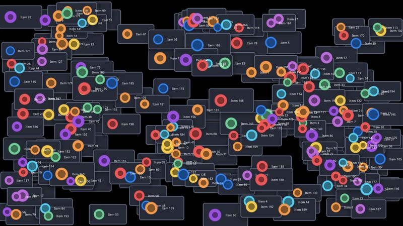
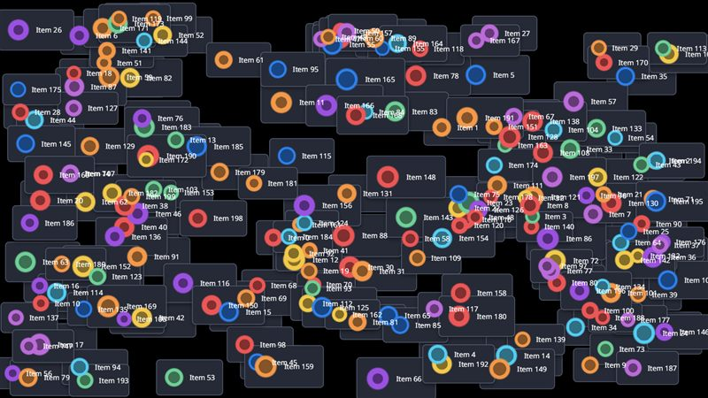

# UI panels

What a game UI draws: cards with a drop shadow, a rounded body and a border, an icon and a line of text each.

- **Engine side:** `Apos.Shapes` for shadows and cards, then `SpriteBatch` for the icons and the `SpriteFont` text, in two batches.
- **Skia side:** Everything on one canvas: shadow and card with `DrawRoundRect`, icons with `DrawAtlas` (one call per texture), text with `DrawText`.

| Engine | Skia (direct) |
|---|---|
|  |  |

Screenshots: 200 cards, KNI DesktopGL. The scenes are 1600x900 and animate every frame.

## Results

<!-- results:begin -->

### MonoGame DesktopGL, H2

| Scene | Native FPS | SkiaGameRendering FPS | Change |
|---|---:|---:|---:|
| UI 50 | 319 (Apos.Shapes + SpriteBatch) | 796 | +150% |
| UI 200 | 215 (Apos.Shapes + SpriteBatch) | 374 | +74% |
| UI 1k | 40 (Apos.Shapes + SpriteBatch) | 78 | +95% |

### KNI DesktopGL, H2

| Scene | Native FPS | SkiaGameRendering FPS | Change |
|---|---:|---:|---:|
| UI 50 | 649 (Apos.Shapes + SpriteBatch) | 723 | +11% |
| UI 200 | 115 (Apos.Shapes + SpriteBatch) | 374 | +225% |
| UI 1k | 63 (Apos.Shapes + SpriteBatch) | 71 | +13% |

### KNI WebGL (Chrome), H2

| Scene | Native FPS | SkiaGameRendering FPS | Change |
|---|---:|---:|---:|
| UI 200 | 24 (Apos.Shapes + SpriteBatch) | 265 | +1004% |
| UI 1k | 5 (Apos.Shapes + SpriteBatch) | 71 | +1320% |

<!-- results:end -->

## Reading the numbers

- Desktop: Skia is 11-225% faster. Skia draws everything in one pass, where the engine side needs `Apos.Shapes` and a second `SpriteBatch`, and on MonoGame DesktopGL the engine side stalls often (its 95th-percentile frame is 10-14 times its median).
- Browser: Skia is more than ten times faster, since `Apos.Shapes` and `SpriteBatch` are CPU-bound in WebAssembly. The engine's 50-card browser run is missing (it stalled for a minute), so that row is left out.
